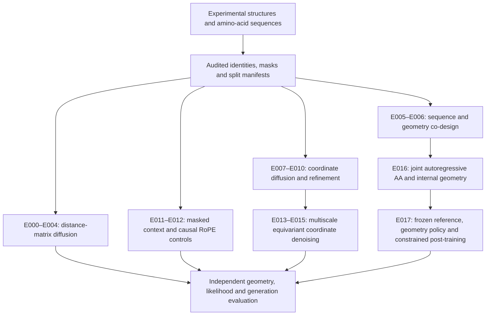

# ProteinGen

**A research study of the gap between learning protein geometry and generating valid structures.**

ProteinGen investigates how representation, symmetry, objectives and evaluation affect protein sequence and Cα structure generation. The progression runs from distance-matrix diffusion to equivariant coordinate denoising, sequence context controls, joint sequence/geometry models and constrained reinforcement-learning post-training.

The strongest contribution is the experimental diagnosis: lower reconstruction error, finite samples and higher proxy reward repeatedly fail to establish protein-like generation. This is a research codebase with positive and negative results, **not a validated protein design system**. No wet-lab validation, thermodynamic stability, biological function or state-of-the-art performance is claimed.

## Research question and architecture

Can structural representations and learning objectives preserve local chain geometry while learning global organization—and can post-training improve useful control without exploiting proxy metrics?



Arrows describe research lineage, not one end-to-end executable model. E010 is reflection-inclusive E(3)/O(3)-equivariant; distances alone cannot encode handedness. E015 uses scalar, polar-vector, pseudoscalar and axial-vector states with an O(3)-typed trunk and an SO(3)-only chiral output. Its local/global multiscale graph and self-conditioning address different limitations from the sequence models. E016/E017 use discrete amino acids and continuous distance/angle/signed-torsion actions; proxy-reward improvement is separate from biological validity.

## Selected evidence

| Study | What the records support | Boundary of the claim |
|---|---|---|
| E000–E004 distance diffusion | Geometric regularizers improve selected matrix consistency metrics; E000/E001 strict geometry acceptance was 0/375. | Compared histories differ; matrix consistency does not establish a valid backbone. |
| E007–E010 coordinate/refinement | Learned denoising; diagnostics expose Cartesian/local-geometry gradient conflict. | E010 Phase 4B's ~1.25% aligned-RMSD gain accompanied local regression. Frozen-panel improvements are not population training benefit. |
| E011–E012 sequence controls | Implemented context shuffles, prefix windows, causal masking and likelihood controls. | A trained contextual model is not evidence of foldability; the later generalization audit is retrospective. |
| E015 multiscale/parity | Recorded same-start adjacent-valid fraction increased 63.260% → 83.783%; local descriptors improved across five lengths. | Twenty primary raw samples; weak evidence of consistent global fold formation. N=192 descriptor energy 4.459 remains above the real-real floor 0.662. |
| E016 J1 continuation | 30,000 additional real-PDB updates; native-prefix-conditioned validation PPL 15.865763 → 15.733081. | Generation safeguard failed; candidate not promoted. This PPL is not an unconditional sequence-only metric. |
| E017 constrained geometry RL | V9.5 expanded validation found filtered K1/K8 yield gains. | Raw K1 and meaningful goal specificity were not established; original promotion failed. Validation was previously exposed. V9.6 arms stopped at 500/250 updates; no equal-budget causal advantage. |

Sources, denominators, checkpoint identities and qualifications: [experiment map](docs/research_progression.md), [E015 report](docs/e015_latest_evaluation_20261012.md), [E016 report](docs/results/e016_global_pretraining.md), [E017 validation](docs/results/e017_v95_validation.md). V9.7 [engineering qualification](docs/results/e017_v97_engineering.md) and subsequent [initialization admission](docs/results/e017_v97_admission.md) are distinct stages; neither report establishes production efficacy. Later launch scripts remain in the source snapshot; this presentation does not infer a completed campaign from their existence.

## What is on this branch

- [Distance diffusion](src/protein_distance_diffusion/diffusion/) and [models](src/protein_distance_diffusion/models/): historical baselines, coordinate refinement, and selected E013/E015 denoiser components.
- [Sequence models](src/protein_sequence_generation/): independent causal Transformer plus E011 masked-context and E012 diagnostic utilities.
- [Joint geometry foundations](src/protein_joint_sac/): typed build contracts, signed Cα construction, transformed action densities and soft-target equations. This subset is **not the full SAC trainer**.
- [Tests](tests/), [configurations](configs/), original reports and an [integration provenance ledger](docs/publication/integration_sources.json).

Implemented, trained, evaluated and proposed are separate statuses in the [experiment map](docs/research_progression.md). Coupled E014/E015 runtime controllers, E016 training/oracle systems and E017 production campaigns remain on their [original branches](docs/publication/branches.md). No snapshot or experiment was merged wholesale.

## Reproduce the software checks

Python 3.11+; use an isolated environment and the PyTorch build appropriate to your platform:

```bash
python -m venv .venv
source .venv/bin/activate
python -m pip install -e '.[dev]'
CUDA_VISIBLE_DEVICES='' OMP_NUM_THREADS=2 python -m pytest -q \
  tests/sequence tests/test_e011_sequence_context.py \
  tests/test_e013_unconditional_equivariant_denoiser.py \
  tests/test_e015_multiscale.py tests/test_e015_parity_equivariance.py \
  tests/test_e015_losses.py tests/test_e015_pcgrad.py \
  tests/test_e015_self_conditioning.py tests/test_public_joint_geometry.py
```

These CPU tests use synthetic fixtures and require no checkpoint, data download or training campaign. Install dependencies before running them. [Validation results](docs/publication/validation.md) distinguish this tested subset from historical tests that depend on unavailable artifacts or machine-specific paths. Dependencies are not fully pinned; the retained [environment records](environment/) document historical runs rather than a portable lockfile.

A clean source clone does **not** reproduce numerical research results: those require the exact external datasets, splits, normalization, checkpoints, seeds and evaluation manifests. Weights and data are not bundled. Historical launch scripts may enforce source seals and local paths; do not treat them as portable commands. See [reproducibility](docs/reproducibility.md) and [baseline usage](docs/baseline_usage.md) for the distinction.

## Methodology and limitations

Evaluation separates teacher-forced/native-prefix likelihood, noisy-input reconstruction, free generation, and filtered-controller outcomes. Split/identity provenance, train-only calibration, immutable checkpoints, paired comparisons and explicit failure gates are part of the research. Bootstrap intervals are conditional on the sampled identities and fitted model; they do not establish independence across protein families or training seeds. Later E017 records explicitly mark historical TEST access as unknown; this repository does not certify an untouched final test set.

Most later comparisons are bounded, sometimes use one training seed, and depend on private local artifacts. Development reuse limits independent confirmation. Cα geometry omits side chains and chemistry. Finite samples, novelty, language-model likelihood and fold-prediction confidence cannot substitute for experimental validation. Proposed future work is identified as proposed, never counted as an executed result.

## License and provenance

Original project code is MIT licensed; derived modules retain separate [third-party notices](THIRD_PARTY_NOTICES.md). ProteinMPNN/ProGen2 architecture compatibility does not grant a license to their weights or external datasets. No vendor payloads, datasets or checkpoints are added by this integration. The [publication audit](docs/publication/audit.md) records what was checked and what remains uncertain. Original experiment history and the [2026-11-16 snapshot](https://github.com/simostocco/proteinGen/tree/2030c692e6ebb90ddff05a91746f29978217ca65) are preserved.
