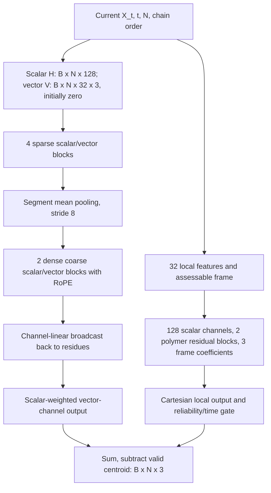

# E013 unconditional scalar/vector coordinate generator v1

Base: `bc5ae4fe83a710f8b89401fa1d2b2d586f193d6e`.
Branch: `e013_unconditional_se3_coordinate_generator_v1`.
Worktree: `/mnt/d/Simone/proteinGen/.e013_worktree`.
Artifacts: `/mnt/d/Simone/proteinGen/e013_artifacts`.

## Scientific question and status

E007 separated denoiser quality from reverse-trajectory quality and enforced O(3)
symmetry, preventing explicit chirality sensitivity. E010 found local geometry
could conflict with Cartesian descent; its auxiliary diagnostic did not establish
sustained training benefit. E013 asks whether directional residue states and a
parity-sensitive local branch improve the same E007 coordinate-v target.

Architecture implemented; twelve CPU tests passed including N=500 backward.
CUDA preflight passed; matched training and one-step evaluation completed.
Stage C **failed**; Stage D/E **not run because gates did not authorize them**.
One-step denoising cannot establish de novo generation,
foldability, stability or function.

## Inference information and tensors

The required distribution is **p(X | N)**. No amino-acid sequence is required.
Forward arguments are only noisy coordinates `[B,N,3]`, integer timestep `[B]`,
length `[B]`, and contiguous-prefix mask `[B,N]`. Connectivity follows chain
order. Current coordinates are centered internally; padding is sliced away before
computation, including nonfinite padded coordinates. N>=2 is supported.
There are no teacher corrections, targets, RMSD, shield or SLSQP inputs.

Time: 32 sine/cosine frequencies, 64->64->64 SiLU MLP. Length features
`N/500, log(N)/log(500), 1/sqrt(N)` project 3->16->16. Position features
`i/(N-1), exp(-i/8), exp(-(N-1-i)/8), exp(-i/32), exp(-(N-1-i)/32)`.
Concatenated 85 scalars project to 128. No E012 length stack is used.

## Edges, radial basis and messages

Directed edges are the unique union of offsets +/-1/2/3 and 24 current-coordinate
nearest neighbors. Stable distance sort resolves exact ties by chain index;
row-major extraction fixes edge order. Spatial provenance remains set on an edge
also supplied by polymer order. All selected edges use `r=x_j-x_i`, `d=||r||`,
`u=r/(d+1e-6)`. kNN at maximal noise has no biological interpretation.

22 edge scalars: 16 Gaussian RBFs; signed `(j-i)/(N-1)`;
`log(1+|j-i|)/log(max(N,2))`; indicators for separations 1/2/3; spatial flag.
RBF centers are uniformly spaced 0..5; gamma is inverse squared spacing.
These are overlapping Gaussian functions, not hard bins. The frozen scale
12.22820347644835 Å means the range extends to 61.14101738224175 Å.
The verified train-only normalization hash is
`1be9ef05c82110861482eb46e61ef433045fa9678b9cdfffd921f0defebb03cd`.
Source: original `coordinate_normalization_v1/normalization.json` under E007
reports. Its fitted identity hash is
`d3f2ee345d0e4e9a27d0136aad1eca9dfe87821a3a82d90aa4c3194bd928a3f9`.

Each block pre-normalizes H with LayerNorm. V is divided by
`sqrt(1+mean_c ||V_c||²)`. Invariants `dot(V_i,c,u_ij)` join h_i/h_j,
22 edge scalars and 64 time scalars in the message MLP. It emits 128 scalar
messages, 32 directional coefficients, 32 vector gates, and one attention logit.
32-dimensional q/k apply RoPE to interleaved pairs using frequencies
`10000^(-m/16)`, m=0..15 and signed chain positions. Edge logits add q_i·k_j/sqrt(32).
Stable per-receiver softmax weights vector messages `a*u+tanh(b)*V_j`.
Scalar-channel linear vector mixing and scalar MLP updates use residual factor
0.1. Scalar updates include vector norms; no raw xyz enters scalar MLPs.

Coarse nodes are contiguous segments: `segment(i)=floor(i/8)`, M=ceil(N/8).
H_c,V_c,X_c are arithmetic means over actual segment membership. Counts exclude
padding and include the partial final segment. Coarse directed all-pairs edges
exclude self; RoPE uses segment order. After two blocks, scalar and vector channel
linear maps broadcast segment states by membership and add them to residues.

## Local features and output

Use a=x_i-x_(i-1), b=x_(i+1)-x_i, e1=b/||b||,
e2=normalize(a-dot(a,e1)e1), e3=cross(e1,e2). Frame columns are e1/e2/e3.
Missing neighbors or norms <=1e-6 mark invalid frames and set the frame to zero;
denominator protection never supplies a global fallback axis.

32 features: six distances, eighteen frame coordinates at offsets -3/-2/-1/+1/+2/+3,
angle cosine, torsion sine/cosine, normalized triple product, frame validity,
torsion validity, sin(angle) reliability, and fraction of available neighbors.
For a,b,c consecutive bonds, torsion uses n1=normalize(a×b), n2=normalize(b×c):
cos=dot(n1,n2), sin=dot(cross(n1,n2),normalize(b)); q=dot(a×b,c)/(||a||||b||||c||).
These signed terms change under reflections. Invalid torsions are zero with
explicit validity. Local features project to 128; two mean-neighbor polymer
residual blocks feed a 3-coefficient head. Frame multiplication returns `[N,3]`.

Global output is `sum_c MLP(H)_c V_c / sqrt(32)`.
Local multiplier is `sigmoid(MLP(time,reliability))*reliability*(1-t/499)^2`.
This declared smooth envelope suppresses high-noise frames; it is a design choice
requiring a later ablation. Sum global and gated local outputs, then subtract the
valid centroid. All operations guarantee translation invariance and proper
rotation equivariance mathematically; reflections are deliberately unconstrained.

## Diffusion, loss, comparison and gates

Reuse E007 `CoordinateVPDiffusion(500)` read-only, including cosine schedule:
X_t=alpha_t X0+sigma_t epsilon; v*=alpha_t epsilon-sigma_t X0;
X0_hat=alpha_t X_t-sigma_t v_hat. X0 and Gaussian epsilon are centered.
Normalize clean coordinates by the frozen scale. Loss is mean over proteins of
masked squared component error divided by 3N_valid. The local offset-distance
auxiliary helper is available but all auxiliary coefficients are zero.
Historical E007 config has auxiliary losses: the prospective comparison must
train the E007 architecture with the same v-only objective and matched corruptions,
optimizer/exposure. A historical checkpoint alone has this objective confound.

Preflight thresholds fixed before real-data evaluation: max and relative rotation
error <=5e-5; finite output and gradients; reflection discrepancy >1e-6;
N=500 peak reserved memory <=5 GiB. Synthetic nonzero reflected-output difference
is an implementation check, not a chirality performance metric.
CPU smoke uses one thread while the 16-thread UniRef50 MMseqs job is active.

Stage C requires verified source/shard and conservative 30%-identity/80%-coverage
clean-validation provenance, deterministic bounded training and prospective
validation identities in five length strata, and frozen training-only numeric
thresholds for aggregate non-inferiority, length regression, collapse and one
failure-family improvement. Noise steps proposed: 5/50/250/400/490. No test tuning.
Diagnostics must include aligned reference error, v loss, offsets 1/2/3,
adjacent distribution, torsions/triple sign and denominators, clashes, gyration,
contacts, finite/collapse and length/noise strata. Stage D requires C evidence;
it must distinguish target-associated rollout diagnostics from unconditional
generation. Stage E requires C and D pass and uses target-independent metrics.
Numeric scientific gates are not yet frozen; C is not authorized by preflight alone.

## Complexity and limitations

Polymer messages O(N), spatial messages O(kN), coarse communication O((N/8)²),
local features/messages O(N). **Current kNN construction uses dense cdist and
stable sorting: O(N² log N) time and O(N²) storage.** Edge discovery therefore is
not fully linear; only residue message blocks are sparse. E007 dense pair-grid
states scale O(N²). This pilot processes variable-length proteins separately.
Message and attention state at coarse nodes are dense only in M.

Self-conditioning, time-aware radial basis, flow matching, richer backbone and
sequence conditioning are proposed future experiments, not implemented/activated.
Optional geometry helper is prepared only. This branch preserves all historical
E007/E010 files and artifacts. No biochemical claim follows from any current check.

## Execution record

Plan and CUDA preflight executed at architecture commit
`5dd02cd5475133ab51ca36a37b69dad454926e43`, configuration hash
`301fddb0e47ba8caa09082cfde5baa85a570581364c365cdb136cbfb7c81f07f`.
Parameter count **980,794**. Environment: PyTorch 2.13.0+cu130, CUDA 13.0;
GPU RTX 5060 8151 MiB, driver 610.57.01. TF32 disabled, float32 throughout.
Synthetic timings are five-call means under concurrent sequence-production CPU
load; nonmonotonic values should not be interpreted as throughput scaling laws.

| N | Forward ms | Forward/backward ms | Peak allocated MiB | Reserved MiB | Max symmetry error |
|---|---:|---:|---:|---:|---:|
|64|67.36|482.84|108.93|116|6.33e-8|
|128|52.84|234.66|152.55|176|1.04e-7|
|256|100.78|376.22|242.56|278|1.19e-7|
|384|71.13|179.65|346.31|376|7.45e-8|
|500|47.18|230.57|435.50|486|9.69e-8|

Relative equivariance errors ranged 4.10e-7..5.91e-7; all finite and memory
gates passed. Reflection discrepancies were 0.95..2.63 L2, confirming the
active branch is not constrained to O(3). Immutable reports: `plan_cpu.json`,
`preflight_cuda.json` under the artifact directory. The CPU test suite passed.

Stage C protocol now implemented: preserve the historical bounded panel, intersect
validation identities with the hash-verified identity-30 clean manifest, and verify
each selected source shard against the immutable dataset protocol. This yields
20 training and 17 validation identities (four per stratum except one at 385–500).
Projected data reads never request sequence. Full dataset rehash is not required
for unselected shards; all accessed shards are hashed.
Proposed bounded exposure: 400 AdamW updates/model, physical batch one, lr 2e-4,
weight decay 0.01, clip 1. Both models receive identical clean proteins, t and epsilon.
No checkpoint selection uses validation. E007 parameter count is recorded at launch.

The prospective gate algorithm is fixed before calibration: use initial control
training-only duplicate noise-replicate v losses at t=250; let delta be their
paired-difference standard deviation divided by sqrt(2). Aggregate tolerance is
`min(0.10,max(0.02,2*delta/(sqrt(n_train)*mean_train_loss)))`; length tolerance is
twice this. Require >=5% local-distance or torsion MSE improvement, finite outputs,
and no reconstruction with radius less than 25% of its reference. Freeze these
values in protocol.json before any prospective validation inference. This is a
feasibility gate, not a claim of statistical superiority or training convergence.
The pre-execution protocol was committed at
`669a7aeecf74d34095a853d3ba7ebbc37afe1111`. Training and prospective validation
were subsequently completed at this fixed boundary; results follow.

Additional block shapes for one unpadded protein: edge list `[E]`, edge scalar
features `[E,22]`, units `[E,3]`, invariant vector/unit dots `[E,32]`, message
MLP input `[E,374]`, output `[E,193]`, scalar messages `[E,128]`, vector
messages `[E,32,3]`, attention weights `[E]`. Coarse tensors are `[M,128]`,
`[M,32,3]`, `[M,3]`; M=63 for N=500. Local tensors are `[N,32]`, frame
`[N,3,3]`, hidden `[N,128]`, frame coefficients `[N,3]`, scalar gate `[N]`.
Channel-linear broadcast reproduces `[N,128]` and `[N,32,3]` before output.

## Completed Stage C result

Both models trained for 400 updates with identical exposure. E007 control has
7,586,505 parameters; E013 has 980,794. Calibration froze aggregate tolerance
0.02 and per-length tolerance 0.04 before validation inference. Training-only
paired-noise SD was 0.048276843988062174. Neither hyperparameters nor checkpoints
were selected from validation; no held-out test was accessed. Training/evaluation
wall time was 340.65 seconds, excluding source preparation and initial calibration.
Boundary files are `one_step_v1/protocol.json`, `panel_provenance.json`,
`training.jsonl`, `metrics.json`, `report.json`, and both final checkpoints.

Aggregate validation v-MSE: 0.644456 -> 0.599271 (**-7.01%**).
Reconstructed X0 component MSE: 40.6944 -> 39.1650 Ų; aligned RMSD:
8.1791 -> 8.1475 Å. Mean offsets-1/2/3 distance MSE:
9.12348 -> 12.36856 Ų (**+35.57%**). Torsion sine/cosine MSE:
1.53014 -> 1.49875 (**-2.05%**), below the predeclared 5% improvement requirement.
Triple-product sign inversion: 0.39582 -> 0.39268, with explicit assessability
counts retained per identity/timestep. Aggregate non-neighbor clash fraction
increased 0.02461 -> 0.06339. These are equal-protein means across five timesteps.

Gate decision: finite **pass**, aggregate non-inferiority **pass**, length-v
non-regression **pass**, predeclared local/chirality improvement **fail**,
reconstruction radius/collapse **fail**. The latter fails at t=490 for 10/17
E013 validation proteins versus 2/17 controls. Minimum E013 radius/reference
ratio was 0.07553. Near-maximal-noise posterior-mean reconstruction can shrink;
this gate does not by itself diagnose reverse-trajectory collapse. No reverse
trajectory, exposure-gap measurement or de novo sample was produced.

Important limits: this is a bounded pilot, not a convergence study. Parameter
count differs by 7.73x, so the result does not isolate representation from capacity.
Only one validation protein occupies 385–500. The original historical panel had
already been used in historical work; it was fixed before E013 training and is
prospective only with respect to this new model, not a newly collected population.
No population-level long-chain or biochemical claim is justified. Low-noise local
distance MSE did improve at t=5, but this does not rescue the aggregate gate.

Future low-noise local/torsion/clash helper functions are prepared and tested,
but remain inactive. Source formatting and these unused helpers were finalized
after the frozen training run; they do not alter its primary loss or model math.

## Recommended next experiment (proposed, not run)

**E014 unconditional coordinate-v local-branch ablation v1:** compare the same
E013 trunk with the local branch enabled versus disabled, starting from matched
initializations and identical training exposure. Keep centered VP, scale, v target,
schedule, objective and sampler fixed. Use training-only noise-resolved head
contributions/geometry diagnostics to investigate t=250/400 local regression and
the global-only near-maximal-noise shrinkage, then freeze fresh prospective gates.
Retain p(X|N); no sequence conditioning or auxiliary loss in this ablation. It is
not a proposed full-generation campaign and is not authorized by this failed gate.

## Validation metrics by noise and length

All entries are equal-protein means; local MSE is in Ų. Detailed bond
quantiles, offsets, chirality assessability counts, contact/clash/radius metrics
and split-specific records remain in metrics.json and report.json.

### Noise strata

| Stratum | Control v-MSE | E013 v-MSE | Control local MSE | E013 local MSE | Control torsion MSE | E013 torsion MSE |
|---|---:|---:|---:|---:|---:|---:|
| 5 | 1.095715 | 0.961120 | 0.2725 | 0.2472 | 0.0706 | 0.0669 |
| 50 | 0.606754 | 0.557722 | 3.7447 | 3.7467 | 1.4735 | 1.4076 |
| 250 | 0.270493 | 0.288559 | 8.2217 | 14.6531 | 1.9762 | 1.9765 |
| 400 | 0.479174 | 0.462675 | 17.3557 | 25.7120 | 2.1031 | 2.0165 |
| 490 | 0.770146 | 0.726280 | 16.0229 | 17.4839 | 2.0273 | 2.0262 |

### Length strata

| Stratum | Control v-MSE | E013 v-MSE | Control local MSE | E013 local MSE | Control torsion MSE | E013 torsion MSE |
|---|---:|---:|---:|---:|---:|---:|
| 20-64 | 0.595332 | 0.561738 | 6.1042 | 11.5324 | 1.5675 | 1.5084 |
| 65-128 | 0.561429 | 0.536496 | 7.0014 | 12.9062 | 1.5603 | 1.5108 |
| 129-256 | 0.643760 | 0.603369 | 8.8233 | 13.6433 | 1.5112 | 1.4894 |
| 257-384 | 0.692998 | 0.636820 | 11.4887 | 12.3083 | 1.4965 | 1.4959 |
| 385-500 | 0.981684 | 0.833918 | 21.4286 | 8.7048 | 1.4699 | 1.4608 |

## Post-training symmetry and matched resource audit

The trained checkpoint passed ten proper-rotation/translation checks over
N=20/500 and all five noise steps. Maximum absolute error 9.54e-7, maximum
relative L2 error 2.54e-7, maximum centroid magnitude 2.38e-8.
Both are below the 5e-5 symmetry tolerance. Initial reflection and geometry
tests passed; trained symmetry checks here concern proper rotations/translations.

| Model | N | Forward ms | Forward/backward ms | Peak allocated MiB | Reserved MiB |
|---|---:|---:|---:|---:|---:|
| e007_control | 64 | 68.89 | 484.60 | 151.58 | 186 |
| e007_control | 128 | 50.34 | 380.62 | 410.42 | 488 |
| e007_control | 256 | 57.52 | 461.76 | 1370.12 | 1622 |
| e007_control | 384 | 44.68 | 335.98 | 3006.87 | 3568 |
| e007_control | 500 | 79.52 | 359.43 | 5213.79 | 6918 |
| e013 | 64 | 86.89 | 295.98 | 108.68 | 142 |
| e013 | 128 | 101.38 | 235.60 | 153.24 | 182 |
| e013 | 256 | 73.88 | 347.57 | 242.68 | 276 |
| e013 | 384 | 45.52 | 258.93 | 343.40 | 374 |
| e013 | 500 | 54.77 | 234.15 | 433.75 | 480 |

Report: trained_boundary_audit_v2.json. The first audit retained a closure
reference to the previous model during allocator reset; it is preserved as
trained_boundary_audit.json. Version 2 explicitly releases that reference.
Reported runtime remains sensitive to concurrent host CPU load and allocator
history; memory and latency are empirical measurements, not asymptotic proofs.

Twelve final tests passed; JUnit record is unit_tests_final.xml. Ruff and diff
whitespace checks passed. Historical model/diffusion/loss/config hashes match
the base commit; normalization hash is unchanged. The MMseqs production job
remained active on 16 threads at the post-training audit and was never stopped
or modified. Runtime paths, caches, scratch, panel, logs and checkpoints were
audited under /mnt/d. All accessed immutable source hashes are checked again
after execution in source_preservation_after.json.

## Files and reproducibility records

New source: models/e013_unconditional_equivariant_denoiser.py,
training/e013_losses.py, evaluation/e013_one_step_benchmark.py under
src/protein_distance_diffusion; scripts/run_e013_unconditional_equivariant_denoiser.py,
scripts/run_e013_one_step_benchmark.py, scripts/audit_e013_trained_boundary.py;
configs/e013_unconditional_equivariant_denoiser_v1.yaml; both test_e013 files;
this document. Only existing README.md and docs/experiment_timeline.md receive
concise E013 status additions. No existing scientific implementation changed.

Stage commits: architecture 5dd02cd5475133ab51ca36a37b69dad454926e43;
preflight/config/docs 4299d4e; frozen benchmark 669a7aeecf74d34095a853d3ba7ebbc37afe1111.
Config SHA256: 301fddb0e47ba8caa09082cfde5baa85a570581364c365cdb136cbfb7c81f07f.
Panel provenance SHA256: 067ab8469dab6c103f15c1bb61edb24ddd69ed02d9db18c28f3af4b279912fb8.
E013 checkpoint SHA256: 2c1b9ae06e88f08fdf7ecbb7a66173f8048b1ae0144c61e91eced6972392bd9e.
Exact selected identities and every accessed dataset/source hash are in
panel_provenance.json. Final commit and artifact hashes are recorded after
closeout in /mnt/d/Simone/proteinGen/e013_artifacts/completion_manifest.json.
No Stage D/E execution commits exist because their prerequisites failed.
