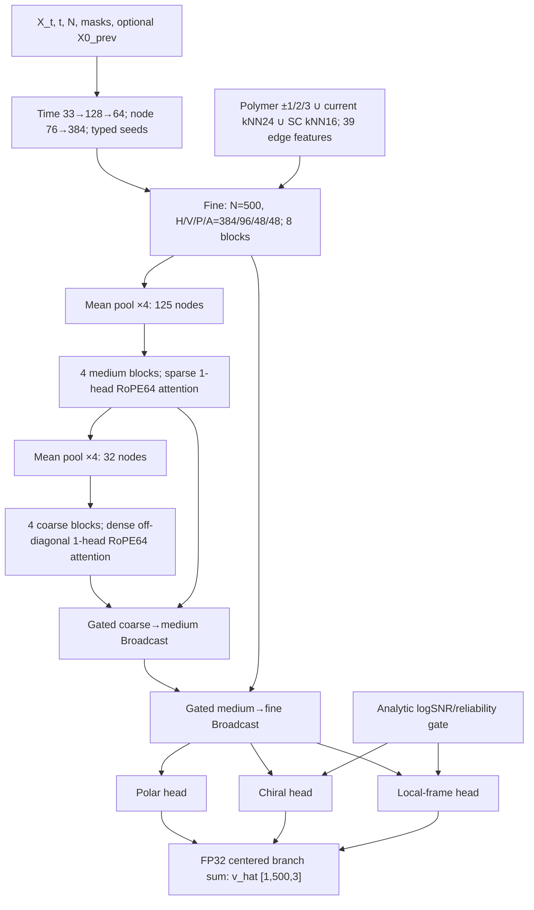

# E015 architecture and parameter audit

Exact production architecture: **33,128,139 trainable parameters**, asserted from the CPU model created by the production `Engine` factory. Audited source commit `f6c63c5c587472234f0e2d78f7124717b7507eee`.

The supervisor launches the trainer; it does not construct a model itself. This audit calls the same Engine constructor with the exact YAML model arguments, frozen calibrated parity midpoint, and selected BF16 policy. It constructs a fresh CPU replica, not the running learned weights. No checkpoint is loaded or rewritten. The production source/config/calibration contract matches the current certificate before and after the audit.

Config SHA256: `13794ef05d8bdf2a80695f9a57292c4ce5fe0f064d64a0fd0aadfcce3958e4fe`. Calibration SHA256: `6c509a6559a6cb80d66debeaad582b315d95ee43873a1f346337c8262c16a536`. Torch: `2.13.0+cu130`.

## Architecture



```text
Inputs [1,500,3], t/N [1], mask [1,500], SC coordinates [1,500,3]
  -> time [64] + scalar geometry [500,12] -> H/V/P/A embedding
  -> FINE [500]: 8 typed blocks (polymer + kNN24 + SC kNN16)
       | skip                                  |
       |                               mean pool stride4
       |                                       v
       |                       MEDIUM [125]: 4 RoPE64 attention blocks
       |                              | skip           |
       |                              |         mean pool stride4
       |                              |                v
       |                              |       COARSE [32]: 4 dense attention blocks
       |                              +<-- gated Broadcast --+
       +<---------------- gated Broadcast ----+
  -> polar [500,3] + gated chiral [500,3] + gated local-frame [500,3]
  -> FP32 valid-residue centering -> v_hat [1,500,3]
```

## Disjoint parameter accounting

Counts below sum exactly to the total. Group containers/functional operations have zero direct parameters; their recursive totals contain the listed module paths. Learned edge processing lives inside each block message MLP, with no separate edge embedding weights. Length and self-conditioning use shared input features/seeds, with no standalone learned tables. Decoder gates are included in their decoders. Buffers are excluded.

| Component | Module paths | Direct | Recursive | % total | Checkpoint region |
|---|---|---:|---:|---:|---|
| Input/time/length/self-conditioning embeddings | time, input, vinit, ainit, pinit | 0 | 190,448 | 0.57488288% | False |
| Fine edge embeddings (functional RBF/geometry; no learned edge-only module) | functional/none | 0 | 0 | 0.00000000% | False |
| Fine block 1 | fine.0 | 0 | 2,000,208 | 6.03779162% | True |
| Fine block 2 | fine.1 | 0 | 2,000,208 | 6.03779162% | True |
| Fine block 3 | fine.2 | 0 | 2,000,208 | 6.03779162% | True |
| Fine block 4 | fine.3 | 0 | 2,000,208 | 6.03779162% | True |
| Fine block 5 | fine.4 | 0 | 2,000,208 | 6.03779162% | True |
| Fine block 6 | fine.5 | 0 | 2,000,208 | 6.03779162% | True |
| Fine block 7 | fine.6 | 0 | 2,000,208 | 6.03779162% | True |
| Fine block 8 | fine.7 | 0 | 2,000,208 | 6.03779162% | True |
| Fine-to-medium pooling (functional mean stride 4) | functional/none | 0 | 0 | 0.00000000% | False |
| Medium block 1 | medium.0 | 0 | 2,049,400 | 6.18628170% | True |
| Medium block 2 | medium.1 | 0 | 2,049,400 | 6.18628170% | True |
| Medium block 3 | medium.2 | 0 | 2,049,400 | 6.18628170% | True |
| Medium block 4 | medium.3 | 0 | 2,049,400 | 6.18628170% | True |
| Medium-to-coarse pooling (functional mean stride 4) | functional/none | 0 | 0 | 0.00000000% | False |
| Coarse block 1 | coarse.0 | 0 | 2,049,400 | 6.18628170% | True |
| Coarse block 2 | coarse.1 | 0 | 2,049,400 | 6.18628170% | True |
| Coarse block 3 | coarse.2 | 0 | 2,049,400 | 6.18628170% | True |
| Coarse block 4 | coarse.3 | 0 | 2,049,400 | 6.18628170% | True |
| Coarse-to-medium decoding | up_medium | 0 | 164,740 | 0.49728118% | False |
| Medium-to-fine decoding | up_fine | 0 | 164,740 | 0.49728118% | False |
| Polar output head | polar_v, polar_p | 0 | 39,264 | 0.11852160% | False |
| Chiral output head | chiral_a, chiral_p | 0 | 23,088 | 0.06969302% | False |
| Local-frame head | local | 0 | 148,995 | 0.44975361% | False |
| Chiral/reliability gates (analytic; decoder gates counted with decoders) | functional/none | 0 | 0 | 0.00000000% | False |
| Remaining trainable modules | functional/none | 0 | 0 | 0.00000000% | False |

**Total: 33,128,139.**

## Precision and checkpoint semantics

All trainable weight/bias tensors are stored as FP32, including raw master weights; EMA is a separate FP32 copy excluded from the trainable total. Production uses CUDA BF16 autocast for Linear GEMMs. Learned projections are cast to FP32 before geometric products/reductions, local-frame products and final centering. kNN squared distances/tie sorting use FP64. Frames, torsions, chirality, vector normalizations and graph features use FP32.

The CPU forward uses BF16 autocast to observe activation shapes and dtypes without GPU access. Those are CPU observations; CUDA policy is audited from source rather than probing the live trainer. CUDA autocast runs LayerNorm in FP32, including its FP32 affine tensors. CPU LayerNorm preserves its input dtype: the first fine norm has BF16 input/output in this trace; later residual H is FP32. The installed Torch 2.13 `include/ATen/autocast_mode.h` lists layer_norm/native_layer_norm under AT_FORALL_FP32. [PyTorch AMP documentation](https://docs.pytorch.org/docs/2.14/amp.html#cuda-ops-that-can-autocast-to-float32) explains the general CUDA policy; the installed header is the exact-version evidence recorded in JSON.

All 16 TypedBlocks and their descendant layers are inside non-reentrant checkpoint regions in gradient-enabled training. Checkpointing requires training=True, the enabled configuration flag, and gradients enabled. It is correctly inactive in this no-gradient forward. Embeddings, mean pooling, decoder Broadcasts and heads are not checkpointed.

## Synthetic activation trace

B=1, N=500, timestep 50; seed 150150500. Both current and previous coordinates are independent synthetic Gaussian FP32 tensors. Self-conditioning availability is true to exercise both graphs. Packed typed states omit the outer batch axis. H/V/P/A mean scalar/polar/pseudoscalar/axial. Raw branch intermediates are reconstructed from projection hook outputs without rerunning learned layers.

| Stage | Observed shapes and dtypes |
|---|---|
| `inputs` | `{"lengths": {"device": "cpu", "dtype": "torch.int64", "shape": [1]}, "noisy_coordinates": {"device": "cpu", "dtype": "torch.float32", "shape": [1, 500, 3]}, "residue_mask": {"device": "cpu", "dtype": "torch.bool", "shape": [1, 500]}, "sc_available": {"device": "cpu", "dtype": "torch.bool", "shape": [1]}, "timesteps": {"device": "cpu", "dtype": "torch.int64", "shape": [1]}, "x0_prev": {"device": "cpu", "dtype": "torch.float32", "shape": [1, 500, 3]}}` |
| `fine.embedding` | `{"a": {"device": "cpu", "dtype": "torch.float32", "shape": [500, 48, 3]}, "h": {"device": "cpu", "dtype": "torch.bfloat16", "shape": [500, 384]}, "p": {"device": "cpu", "dtype": "torch.float32", "shape": [500, 48]}, "v": {"device": "cpu", "dtype": "torch.bfloat16", "shape": [500, 96, 3]}}` |
| `fine.frame` | `{"device": "cpu", "dtype": "torch.float32", "shape": [500, 3, 3]}` |
| `fine.reliability` | `{"device": "cpu", "dtype": "torch.float32", "shape": [500]}` |
| `fine.gate` | `{"device": "cpu", "dtype": "torch.float32", "shape": [500]}` |
| `fine.time` | `{"device": "cpu", "dtype": "torch.bfloat16", "shape": [64]}` |
| `fine.0.input` | `{"a": {"device": "cpu", "dtype": "torch.float32", "shape": [500, 48, 3]}, "h": {"device": "cpu", "dtype": "torch.bfloat16", "shape": [500, 384]}, "p": {"device": "cpu", "dtype": "torch.float32", "shape": [500, 48]}, "v": {"device": "cpu", "dtype": "torch.bfloat16", "shape": [500, 96, 3]}}` |
| `fine.0.output` | `{"a": {"device": "cpu", "dtype": "torch.float32", "shape": [500, 48, 3]}, "h": {"device": "cpu", "dtype": "torch.float32", "shape": [500, 384]}, "p": {"device": "cpu", "dtype": "torch.float32", "shape": [500, 48]}, "v": {"device": "cpu", "dtype": "torch.float32", "shape": [500, 96, 3]}}` |
| `fine.1.input` | `{"a": {"device": "cpu", "dtype": "torch.float32", "shape": [500, 48, 3]}, "h": {"device": "cpu", "dtype": "torch.float32", "shape": [500, 384]}, "p": {"device": "cpu", "dtype": "torch.float32", "shape": [500, 48]}, "v": {"device": "cpu", "dtype": "torch.float32", "shape": [500, 96, 3]}}` |
| `fine.1.output` | `{"a": {"device": "cpu", "dtype": "torch.float32", "shape": [500, 48, 3]}, "h": {"device": "cpu", "dtype": "torch.float32", "shape": [500, 384]}, "p": {"device": "cpu", "dtype": "torch.float32", "shape": [500, 48]}, "v": {"device": "cpu", "dtype": "torch.float32", "shape": [500, 96, 3]}}` |
| `fine.2.input` | `{"a": {"device": "cpu", "dtype": "torch.float32", "shape": [500, 48, 3]}, "h": {"device": "cpu", "dtype": "torch.float32", "shape": [500, 384]}, "p": {"device": "cpu", "dtype": "torch.float32", "shape": [500, 48]}, "v": {"device": "cpu", "dtype": "torch.float32", "shape": [500, 96, 3]}}` |
| `fine.2.output` | `{"a": {"device": "cpu", "dtype": "torch.float32", "shape": [500, 48, 3]}, "h": {"device": "cpu", "dtype": "torch.float32", "shape": [500, 384]}, "p": {"device": "cpu", "dtype": "torch.float32", "shape": [500, 48]}, "v": {"device": "cpu", "dtype": "torch.float32", "shape": [500, 96, 3]}}` |
| `fine.3.input` | `{"a": {"device": "cpu", "dtype": "torch.float32", "shape": [500, 48, 3]}, "h": {"device": "cpu", "dtype": "torch.float32", "shape": [500, 384]}, "p": {"device": "cpu", "dtype": "torch.float32", "shape": [500, 48]}, "v": {"device": "cpu", "dtype": "torch.float32", "shape": [500, 96, 3]}}` |
| `fine.3.output` | `{"a": {"device": "cpu", "dtype": "torch.float32", "shape": [500, 48, 3]}, "h": {"device": "cpu", "dtype": "torch.float32", "shape": [500, 384]}, "p": {"device": "cpu", "dtype": "torch.float32", "shape": [500, 48]}, "v": {"device": "cpu", "dtype": "torch.float32", "shape": [500, 96, 3]}}` |
| `fine.4.input` | `{"a": {"device": "cpu", "dtype": "torch.float32", "shape": [500, 48, 3]}, "h": {"device": "cpu", "dtype": "torch.float32", "shape": [500, 384]}, "p": {"device": "cpu", "dtype": "torch.float32", "shape": [500, 48]}, "v": {"device": "cpu", "dtype": "torch.float32", "shape": [500, 96, 3]}}` |
| `fine.4.output` | `{"a": {"device": "cpu", "dtype": "torch.float32", "shape": [500, 48, 3]}, "h": {"device": "cpu", "dtype": "torch.float32", "shape": [500, 384]}, "p": {"device": "cpu", "dtype": "torch.float32", "shape": [500, 48]}, "v": {"device": "cpu", "dtype": "torch.float32", "shape": [500, 96, 3]}}` |
| `fine.5.input` | `{"a": {"device": "cpu", "dtype": "torch.float32", "shape": [500, 48, 3]}, "h": {"device": "cpu", "dtype": "torch.float32", "shape": [500, 384]}, "p": {"device": "cpu", "dtype": "torch.float32", "shape": [500, 48]}, "v": {"device": "cpu", "dtype": "torch.float32", "shape": [500, 96, 3]}}` |
| `fine.5.output` | `{"a": {"device": "cpu", "dtype": "torch.float32", "shape": [500, 48, 3]}, "h": {"device": "cpu", "dtype": "torch.float32", "shape": [500, 384]}, "p": {"device": "cpu", "dtype": "torch.float32", "shape": [500, 48]}, "v": {"device": "cpu", "dtype": "torch.float32", "shape": [500, 96, 3]}}` |
| `fine.6.input` | `{"a": {"device": "cpu", "dtype": "torch.float32", "shape": [500, 48, 3]}, "h": {"device": "cpu", "dtype": "torch.float32", "shape": [500, 384]}, "p": {"device": "cpu", "dtype": "torch.float32", "shape": [500, 48]}, "v": {"device": "cpu", "dtype": "torch.float32", "shape": [500, 96, 3]}}` |
| `fine.6.output` | `{"a": {"device": "cpu", "dtype": "torch.float32", "shape": [500, 48, 3]}, "h": {"device": "cpu", "dtype": "torch.float32", "shape": [500, 384]}, "p": {"device": "cpu", "dtype": "torch.float32", "shape": [500, 48]}, "v": {"device": "cpu", "dtype": "torch.float32", "shape": [500, 96, 3]}}` |
| `fine.7.input` | `{"a": {"device": "cpu", "dtype": "torch.float32", "shape": [500, 48, 3]}, "h": {"device": "cpu", "dtype": "torch.float32", "shape": [500, 384]}, "p": {"device": "cpu", "dtype": "torch.float32", "shape": [500, 48]}, "v": {"device": "cpu", "dtype": "torch.float32", "shape": [500, 96, 3]}}` |
| `fine.7.output` | `{"a": {"device": "cpu", "dtype": "torch.float32", "shape": [500, 48, 3]}, "h": {"device": "cpu", "dtype": "torch.float32", "shape": [500, 384]}, "p": {"device": "cpu", "dtype": "torch.float32", "shape": [500, 48]}, "v": {"device": "cpu", "dtype": "torch.float32", "shape": [500, 96, 3]}}` |
| `fine_to_medium.input` | `{"a": {"device": "cpu", "dtype": "torch.float32", "shape": [500, 48, 3]}, "h": {"device": "cpu", "dtype": "torch.float32", "shape": [500, 384]}, "p": {"device": "cpu", "dtype": "torch.float32", "shape": [500, 48]}, "v": {"device": "cpu", "dtype": "torch.float32", "shape": [500, 96, 3]}}` |
| `fine_to_medium.output` | `{"a": {"device": "cpu", "dtype": "torch.float32", "shape": [125, 48, 3]}, "h": {"device": "cpu", "dtype": "torch.float32", "shape": [125, 384]}, "p": {"device": "cpu", "dtype": "torch.float32", "shape": [125, 48]}, "v": {"device": "cpu", "dtype": "torch.float32", "shape": [125, 96, 3]}}` |
| `medium.0.input` | `{"a": {"device": "cpu", "dtype": "torch.float32", "shape": [125, 48, 3]}, "h": {"device": "cpu", "dtype": "torch.float32", "shape": [125, 384]}, "p": {"device": "cpu", "dtype": "torch.float32", "shape": [125, 48]}, "v": {"device": "cpu", "dtype": "torch.float32", "shape": [125, 96, 3]}}` |
| `medium.0.output` | `{"a": {"device": "cpu", "dtype": "torch.float32", "shape": [125, 48, 3]}, "h": {"device": "cpu", "dtype": "torch.float32", "shape": [125, 384]}, "p": {"device": "cpu", "dtype": "torch.float32", "shape": [125, 48]}, "v": {"device": "cpu", "dtype": "torch.float32", "shape": [125, 96, 3]}}` |
| `medium.1.input` | `{"a": {"device": "cpu", "dtype": "torch.float32", "shape": [125, 48, 3]}, "h": {"device": "cpu", "dtype": "torch.float32", "shape": [125, 384]}, "p": {"device": "cpu", "dtype": "torch.float32", "shape": [125, 48]}, "v": {"device": "cpu", "dtype": "torch.float32", "shape": [125, 96, 3]}}` |
| `medium.1.output` | `{"a": {"device": "cpu", "dtype": "torch.float32", "shape": [125, 48, 3]}, "h": {"device": "cpu", "dtype": "torch.float32", "shape": [125, 384]}, "p": {"device": "cpu", "dtype": "torch.float32", "shape": [125, 48]}, "v": {"device": "cpu", "dtype": "torch.float32", "shape": [125, 96, 3]}}` |
| `medium.2.input` | `{"a": {"device": "cpu", "dtype": "torch.float32", "shape": [125, 48, 3]}, "h": {"device": "cpu", "dtype": "torch.float32", "shape": [125, 384]}, "p": {"device": "cpu", "dtype": "torch.float32", "shape": [125, 48]}, "v": {"device": "cpu", "dtype": "torch.float32", "shape": [125, 96, 3]}}` |
| `medium.2.output` | `{"a": {"device": "cpu", "dtype": "torch.float32", "shape": [125, 48, 3]}, "h": {"device": "cpu", "dtype": "torch.float32", "shape": [125, 384]}, "p": {"device": "cpu", "dtype": "torch.float32", "shape": [125, 48]}, "v": {"device": "cpu", "dtype": "torch.float32", "shape": [125, 96, 3]}}` |
| `medium.3.input` | `{"a": {"device": "cpu", "dtype": "torch.float32", "shape": [125, 48, 3]}, "h": {"device": "cpu", "dtype": "torch.float32", "shape": [125, 384]}, "p": {"device": "cpu", "dtype": "torch.float32", "shape": [125, 48]}, "v": {"device": "cpu", "dtype": "torch.float32", "shape": [125, 96, 3]}}` |
| `medium.3.output` | `{"a": {"device": "cpu", "dtype": "torch.float32", "shape": [125, 48, 3]}, "h": {"device": "cpu", "dtype": "torch.float32", "shape": [125, 384]}, "p": {"device": "cpu", "dtype": "torch.float32", "shape": [125, 48]}, "v": {"device": "cpu", "dtype": "torch.float32", "shape": [125, 96, 3]}}` |
| `medium_to_coarse.input` | `{"a": {"device": "cpu", "dtype": "torch.float32", "shape": [125, 48, 3]}, "h": {"device": "cpu", "dtype": "torch.float32", "shape": [125, 384]}, "p": {"device": "cpu", "dtype": "torch.float32", "shape": [125, 48]}, "v": {"device": "cpu", "dtype": "torch.float32", "shape": [125, 96, 3]}}` |
| `medium_to_coarse.output` | `{"a": {"device": "cpu", "dtype": "torch.float32", "shape": [32, 48, 3]}, "h": {"device": "cpu", "dtype": "torch.float32", "shape": [32, 384]}, "p": {"device": "cpu", "dtype": "torch.float32", "shape": [32, 48]}, "v": {"device": "cpu", "dtype": "torch.float32", "shape": [32, 96, 3]}}` |
| `coarse.0.input` | `{"a": {"device": "cpu", "dtype": "torch.float32", "shape": [32, 48, 3]}, "h": {"device": "cpu", "dtype": "torch.float32", "shape": [32, 384]}, "p": {"device": "cpu", "dtype": "torch.float32", "shape": [32, 48]}, "v": {"device": "cpu", "dtype": "torch.float32", "shape": [32, 96, 3]}}` |
| `coarse.0.output` | `{"a": {"device": "cpu", "dtype": "torch.float32", "shape": [32, 48, 3]}, "h": {"device": "cpu", "dtype": "torch.float32", "shape": [32, 384]}, "p": {"device": "cpu", "dtype": "torch.float32", "shape": [32, 48]}, "v": {"device": "cpu", "dtype": "torch.float32", "shape": [32, 96, 3]}}` |
| `coarse.1.input` | `{"a": {"device": "cpu", "dtype": "torch.float32", "shape": [32, 48, 3]}, "h": {"device": "cpu", "dtype": "torch.float32", "shape": [32, 384]}, "p": {"device": "cpu", "dtype": "torch.float32", "shape": [32, 48]}, "v": {"device": "cpu", "dtype": "torch.float32", "shape": [32, 96, 3]}}` |
| `coarse.1.output` | `{"a": {"device": "cpu", "dtype": "torch.float32", "shape": [32, 48, 3]}, "h": {"device": "cpu", "dtype": "torch.float32", "shape": [32, 384]}, "p": {"device": "cpu", "dtype": "torch.float32", "shape": [32, 48]}, "v": {"device": "cpu", "dtype": "torch.float32", "shape": [32, 96, 3]}}` |
| `coarse.2.input` | `{"a": {"device": "cpu", "dtype": "torch.float32", "shape": [32, 48, 3]}, "h": {"device": "cpu", "dtype": "torch.float32", "shape": [32, 384]}, "p": {"device": "cpu", "dtype": "torch.float32", "shape": [32, 48]}, "v": {"device": "cpu", "dtype": "torch.float32", "shape": [32, 96, 3]}}` |
| `coarse.2.output` | `{"a": {"device": "cpu", "dtype": "torch.float32", "shape": [32, 48, 3]}, "h": {"device": "cpu", "dtype": "torch.float32", "shape": [32, 384]}, "p": {"device": "cpu", "dtype": "torch.float32", "shape": [32, 48]}, "v": {"device": "cpu", "dtype": "torch.float32", "shape": [32, 96, 3]}}` |
| `coarse.3.input` | `{"a": {"device": "cpu", "dtype": "torch.float32", "shape": [32, 48, 3]}, "h": {"device": "cpu", "dtype": "torch.float32", "shape": [32, 384]}, "p": {"device": "cpu", "dtype": "torch.float32", "shape": [32, 48]}, "v": {"device": "cpu", "dtype": "torch.float32", "shape": [32, 96, 3]}}` |
| `coarse.3.output` | `{"a": {"device": "cpu", "dtype": "torch.float32", "shape": [32, 48, 3]}, "h": {"device": "cpu", "dtype": "torch.float32", "shape": [32, 384]}, "p": {"device": "cpu", "dtype": "torch.float32", "shape": [32, 48]}, "v": {"device": "cpu", "dtype": "torch.float32", "shape": [32, 96, 3]}}` |
| `up_medium` | `{"a": {"device": "cpu", "dtype": "torch.float32", "shape": [125, 48, 3]}, "h": {"device": "cpu", "dtype": "torch.float32", "shape": [125, 384]}, "p": {"device": "cpu", "dtype": "torch.float32", "shape": [125, 48]}, "v": {"device": "cpu", "dtype": "torch.float32", "shape": [125, 96, 3]}}` |
| `up_fine` | `{"a": {"device": "cpu", "dtype": "torch.float32", "shape": [500, 48, 3]}, "h": {"device": "cpu", "dtype": "torch.float32", "shape": [500, 384]}, "p": {"device": "cpu", "dtype": "torch.float32", "shape": [500, 48]}, "v": {"device": "cpu", "dtype": "torch.float32", "shape": [500, 96, 3]}}` |
| `heads.raw_branches_reconstructed_from_projection_hooks` | `{"chiral": {"device": "cpu", "dtype": "torch.float32", "shape": [500, 3]}, "local": {"device": "cpu", "dtype": "torch.float32", "shape": [500, 3]}, "polar": {"device": "cpu", "dtype": "torch.float32", "shape": [500, 3]}}` |
| `heads.components` | `{"assessable": {"device": "cpu", "dtype": "torch.bool", "shape": [500]}, "chiral_effective": {"device": "cpu", "dtype": "torch.float32", "shape": [500, 3]}, "gate": {"device": "cpu", "dtype": "torch.float32", "shape": [500]}, "global_v": {"device": "cpu", "dtype": "torch.float32", "shape": [500, 3]}, "local_effective": {"device": "cpu", "dtype": "torch.float32", "shape": [500, 3]}, "reliability": {"device": "cpu", "dtype": "torch.float32", "shape": [500]}, "shapes": [500, 125, 32]}` |
| `heads.single_v_hat` | `{"device": "cpu", "dtype": "torch.float32", "shape": [500, 3]}` |
| `final.v_hat` | `{"device": "cpu", "dtype": "torch.float32", "shape": [1, 500, 3]}` |

## Synthetic directed graphs

| Scale | Nodes | Polymer edges | Current edges | SC edges | Deduplicated edges | i/j | Features | Unit pairs |
|---|---:|---:|---:|---:|---:|---|---|---|
| fine | 500 | 2988 | 12000 | 8000 | 22400 | [22400] int64 | [22400, 39] FP32 | [22400, 2, 3] FP32 |
| medium | 125 | 738 | 3000 | 2000 | 5191 | [5191] int64 | [5191, 39] FP32 | [5191, 2, 3] FP32 |
| coarse | 32 | 180 | 992 | 512 | 992 | [992] int64 | [992, 39] FP32 | [992, 2, 3] FP32 |

Polymer/current/SC boolean provenance masks have shape [N,N]; directed COO index pairs have [2,E] (the actual graph returns two separate [E] int64 vectors). Fine current kNN indices are [500,24], SC [500,16]; medium [125,24]/[125,16]. Edge union size depends on this specific synthetic geometry, not learned weights. Coarse current connectivity is all 32×31=992 off-diagonal directed pairs; SC and polymer are subsets.

The conceptual coarse dense attention matrix is [32,32] (one head, diagonal excluded). Implementation does **not** allocate that attention matrix: query/key are [32,64], logits/normalized weights are [992], scatter maxima/totals are [32]. Medium uses the same edge-wise softmax on its sparse union. RoPE runs in FP32 on the BF16 query/key projections.

## Exact production settings

```json
{
  "model_config": {
    "scalar_channels": 384,
    "vector_channels": 96,
    "pseudoscalar_channels": 48,
    "axial_channels": 48,
    "fine_blocks": 8,
    "medium_blocks": 4,
    "coarse_blocks": 4,
    "mlp_ratio": 2,
    "k_current": 24,
    "k_self": 16,
    "activation_checkpointing": true,
    "chiral_head": true,
    "parity": true,
    "multiscale": true,
    "self_conditioning": true,
    "gate_width": 1.0
  },
  "rbf_channels_per_distance": 16,
  "rbf_distance_streams": 2,
  "total_rbf_channels": 32,
  "edge_feature_width": 39,
  "rbf_centers": [
    0.0,
    5.0
  ],
  "rbf_spacing": 0.3333333333333333,
  "rbf_gamma": 9.0,
  "time_input_width": 33,
  "time_hidden_width": 128,
  "time_output_width": 64,
  "time_sinusoidal_frequencies": 16,
  "node_embedding_input_width": 76,
  "length_feature": "N/500, one scalar; no separate learned length table",
  "self_conditioning_features": "displacement norm, availability flag, displacement polar seed, kNN geometry; no separate learned SC table",
  "rope_dimensions": 64,
  "rope_pairs": 32,
  "rope_base": 10000,
  "rope_positions": "per-protein pooled residue indices reset in packed batch",
  "attention_heads": {
    "fine": 0,
    "medium": 1,
    "coarse": 1
  },
  "query_key_width": 64,
  "attention_scale": 8,
  "knn_current": 24,
  "knn_self_conditioning": 16,
  "polymer_offsets": [
    -3,
    -2,
    -1,
    1,
    2,
    3
  ],
  "coarse_dense": true,
  "coarse_self_edges": false,
  "knn_distance_dtype": "torch.float64",
  "knn_boundary_tolerance": "32 * FP32 epsilon * max(boundary squared distance,1)",
  "message_mlp": {
    "input": 1063,
    "hidden": 768,
    "output": 720,
    "expansion_ratio": 2
  },
  "feed_mlp": {
    "input": 384,
    "hidden": 768,
    "output": 384,
    "expansion_ratio": 2
  },
  "local_mlp": {
    "input": 384,
    "hidden": 384,
    "output": 3,
    "expansion_ratio": 1
  },
  "normalization": {
    "scalar": "LayerNorm(384), eps=1e-5, affine=True, at block norm and feed.0",
    "polar_axial": "z / sqrt(1 + sum_xyz(z^2)), independently per channel; FP32",
    "pseudoscalar": "odd tanh",
    "pooling": "arithmetic mean of contiguous stride-4 groups, valid counts",
    "final": "FP32 mean centering over valid residues"
  },
  "self_conditioning_probability": 0.5,
  "rollout_probability": 0.1,
  "rollout_warmup_exposures": 115066,
  "rollout_steps": [
    1,
    2,
    3
  ],
  "ema_decay": 0.9999,
  "snr_bins": [
    {
      "bin": 0,
      "count": 63,
      "timestep_min": 437,
      "timestep_max": 499,
      "timesteps_descending": [
        499,
        498,
        497,
        496,
        495,
        494,
        493,
        492,
        491,
        490,
        489,
        488,
        487,
        486,
        485,
        484,
        483,
        482,
        481,
        480,
        479,
        478,
        477,
        476,
        475,
        474,
        473,
        472,
        471,
        470,
        469,
        468,
        467,
        466,
        465,
        464,
        463,
        462,
        461,
        460,
        459,
        458,
        457,
        456,
        455,
        454,
        453,
        452,
        451,
        450,
        449,
        448,
        447,
        446,
        445,
        444,
        443,
        442,
        441,
        440,
        439,
        438,
        437
      ],
      "logsnr_min": -20.75202178955078,
      "logsnr_max": -3.2624588012695312,
      "v_loss_weight": 1.6160974502563477
    },
    {
      "bin": 1,
      "count": 63,
      "timestep_min": 374,
      "timestep_max": 436,
      "timesteps_descending": [
        436,
        435,
        434,
        433,
        432,
        431,
        430,
        429,
        428,
        427,
        426,
        425,
        424,
        423,
        422,
        421,
        420,
        419,
        418,
        417,
        416,
        415,
        414,
        413,
        412,
        411,
        410,
        409,
        408,
        407,
        406,
        405,
        404,
        403,
        402,
        401,
        400,
        399,
        398,
        397,
        396,
        395,
        394,
        393,
        392,
        391,
        390,
        389,
        388,
        387,
        386,
        385,
        384,
        383,
        382,
        381,
        380,
        379,
        378,
        377,
        376,
        375,
        374
      ],
      "logsnr_min": -3.2296340465545654,
      "logsnr_max": -1.780266523361206,
      "v_loss_weight": 1.339951515197754
    },
    {
      "bin": 2,
      "count": 63,
      "timestep_min": 311,
      "timestep_max": 373,
      "timesteps_descending": [
        373,
        372,
        371,
        370,
        369,
        368,
        367,
        366,
        365,
        364,
        363,
        362,
        361,
        360,
        359,
        358,
        357,
        356,
        355,
        354,
        353,
        352,
        351,
        350,
        349,
        348,
        347,
        346,
        345,
        344,
        343,
        342,
        341,
        340,
        339,
        338,
        337,
        336,
        335,
        334,
        333,
        332,
        331,
        330,
        329,
        328,
        327,
        326,
        325,
        324,
        323,
        322,
        321,
        320,
        319,
        318,
        317,
        316,
        315,
        314,
        313,
        312,
        311
      ],
      "logsnr_min": -1.762580394744873,
      "logsnr_max": -0.8197054862976074,
      "v_loss_weight": 0.942997932434082
    },
    {
      "bin": 3,
      "count": 63,
      "timestep_min": 248,
      "timestep_max": 310,
      "timesteps_descending": [
        310,
        309,
        308,
        307,
        306,
        305,
        304,
        303,
        302,
        301,
        300,
        299,
        298,
        297,
        296,
        295,
        294,
        293,
        292,
        291,
        290,
        289,
        288,
        287,
        286,
        285,
        284,
        283,
        282,
        281,
        280,
        279,
        278,
        277,
        276,
        275,
        274,
        273,
        272,
        271,
        270,
        269,
        268,
        267,
        266,
        265,
        264,
        263,
        262,
        261,
        260,
        259,
        258,
        257,
        256,
        255,
        254,
        253,
        252,
        251,
        250,
        249,
        248
      ],
      "logsnr_min": -0.8061932325363159,
      "logsnr_max": -0.012183129787445068,
      "v_loss_weight": 0.7908398509025574
    },
    {
      "bin": 4,
      "count": 62,
      "timestep_min": 186,
      "timestep_max": 247,
      "timesteps_descending": [
        247,
        246,
        245,
        244,
        243,
        242,
        241,
        240,
        239,
        238,
        237,
        236,
        235,
        234,
        233,
        232,
        231,
        230,
        229,
        228,
        227,
        226,
        225,
        224,
        223,
        222,
        221,
        220,
        219,
        218,
        217,
        216,
        215,
        214,
        213,
        212,
        211,
        210,
        209,
        208,
        207,
        206,
        205,
        204,
        203,
        202,
        201,
        200,
        199,
        198,
        197,
        196,
        195,
        194,
        193,
        192,
        191,
        190,
        189,
        188,
        187,
        186
      ],
      "logsnr_min": 0.0002853870391845703,
      "logsnr_max": 0.7799348831176758,
      "v_loss_weight": 0.827787458896637
    },
    {
      "bin": 5,
      "count": 62,
      "timestep_min": 124,
      "timestep_max": 185,
      "timesteps_descending": [
        185,
        184,
        183,
        182,
        181,
        180,
        179,
        178,
        177,
        176,
        175,
        174,
        173,
        172,
        171,
        170,
        169,
        168,
        167,
        166,
        165,
        164,
        163,
        162,
        161,
        160,
        159,
        158,
        157,
        156,
        155,
        154,
        153,
        152,
        151,
        150,
        149,
        148,
        147,
        146,
        145,
        144,
        143,
        142,
        141,
        140,
        139,
        138,
        137,
        136,
        135,
        134,
        133,
        132,
        131,
        130,
        129,
        128,
        127,
        126,
        125,
        124
      ],
      "logsnr_min": 0.7933813333511353,
      "logsnr_max": 1.7112737894058228,
      "v_loss_weight": 0.7751826047897339
    },
    {
      "bin": 6,
      "count": 62,
      "timestep_min": 62,
      "timestep_max": 123,
      "timesteps_descending": [
        123,
        122,
        121,
        120,
        119,
        118,
        117,
        116,
        115,
        114,
        113,
        112,
        111,
        110,
        109,
        108,
        107,
        106,
        105,
        104,
        103,
        102,
        101,
        100,
        99,
        98,
        97,
        96,
        95,
        94,
        93,
        92,
        91,
        90,
        89,
        88,
        87,
        86,
        85,
        84,
        83,
        82,
        81,
        80,
        79,
        78,
        77,
        76,
        75,
        74,
        73,
        72,
        71,
        70,
        69,
        68,
        67,
        66,
        65,
        64,
        63,
        62
      ],
      "logsnr_min": 1.7286498546600342,
      "logsnr_max": 3.1065564155578613,
      "v_loss_weight": 0.8261674046516418
    },
    {
      "bin": 7,
      "count": 62,
      "timestep_min": 0,
      "timestep_max": 61,
      "timesteps_descending": [
        61,
        60,
        59,
        58,
        57,
        56,
        55,
        54,
        53,
        52,
        51,
        50,
        49,
        48,
        47,
        46,
        45,
        44,
        43,
        42,
        41,
        40,
        39,
        38,
        37,
        36,
        35,
        34,
        33,
        32,
        31,
        30,
        29,
        28,
        27,
        26,
        25,
        24,
        23,
        22,
        21,
        20,
        19,
        18,
        17,
        16,
        15,
        14,
        13,
        12,
        11,
        10,
        9,
        8,
        7,
        6,
        5,
        4,
        3,
        2,
        1,
        0
      ],
      "logsnr_min": 3.137611150741577,
      "logsnr_max": 9.210074424743652,
      "v_loss_weight": 0.8809757232666016
    }
  ],
  "v_loss_weights": [
    1.6160974502563477,
    1.339951515197754,
    0.942997932434082,
    0.7908398509025574,
    0.827787458896637,
    0.7751826047897339,
    0.8261674046516418,
    0.8809757232666016
  ],
  "geometry_gates": {
    "loss_formula": "sigmoid((logSNR - midpoint)/width)",
    "midpoints": {
      "distance": 5.124029636383057,
      "torsion": 3.51250958442688,
      "chirality": 3.51250958442688,
      "clash": 5.124029636383057
    },
    "loss_gate_width_logsnr": 1.0,
    "branch_formula": "reliability * sigmoid((logSNR - chirality_midpoint)/gate_width + 2*(reliability-1))",
    "branch_gate_width": 1.0,
    "branch_midpoint": 3.51250958442688,
    "reliability": "sin(local angle) * valid_frame; no trainable parameters"
  },
  "geometry_loss_coefficients": {
    "distance": 17.083404031072213,
    "torsion": 0.9274404147247816,
    "chirality": 1.3079999663494615,
    "clash": 100.0
  },
  "chirality_tau": 0.1,
  "chirality_beta_sign": 0.1,
  "chirality_huber_delta": 1.0,
  "clash_threshold_angstrom": 3,
  "clash_min_chain_separation_exclusive": 3,
  "distance_loss": "mean of L1/L2/L3 squared distance errors, each coefficient lambda_distance/3",
  "coordinate_scale_angstrom": 12.22820347644835,
  "feature_flags": {
    "snr_balancing": true,
    "snr_weighting": true,
    "geometry_losses": true,
    "pcgrad": true,
    "rollout_states": true,
    "ema": true,
    "global_scale_regularizer": false
  }
}
```

SNR bins are equal-sized rank partitions of the frozen logSNR values, ordered from low to high SNR, not equal-width logSNR intervals. The full timestep membership is recorded above and in JSON. Geometry coefficients are frozen calibration values. Structural objectives are equal-protein means; the distance coefficient applies to the mean of L1/L2/L3. Geometry loss gates and the reliability-modulated output/parity gate are distinct.

## Every registered module

Recursive counts overlap parent/child rows and must not be summed. Direct counts sum to the total. Weight/bias tensor names and shapes appear in the next table; JSON also links each module to its direct tensor names and complete input/output hook metadata. Functional stages are in the disjoint accounting table.

| Module | Type | Direct | Recursive | % total (recursive) | In checkpoint region |
|---|---|---:|---:|---:|---|
| `<root>` | E015MultiscaleParityDenoiser | 0 | 33,128,139 | 100.00000000% | False |
| `time` | Sequential | 0 | 12,608 | 0.03805828% | False |
| `time.0` | Linear | 4,352 | 4,352 | 0.01313687% | False |
| `time.1` | SiLU | 0 | 0 | 0.00000000% | False |
| `time.2` | Linear | 8,256 | 8,256 | 0.02492141% | False |
| `input` | Sequential | 0 | 177,408 | 0.53552057% | False |
| `input.0` | Linear | 29,568 | 29,568 | 0.08925343% | False |
| `input.1` | SiLU | 0 | 0 | 0.00000000% | False |
| `input.2` | Linear | 147,840 | 147,840 | 0.44626714% | False |
| `vinit` | Linear | 288 | 288 | 0.00086935% | False |
| `ainit` | Linear | 48 | 48 | 0.00014489% | False |
| `pinit` | Linear | 96 | 96 | 0.00028978% | False |
| `fine` | ModuleList | 0 | 16,001,664 | 48.30233295% | False |
| `fine.0` | TypedBlock | 0 | 2,000,208 | 6.03779162% | True |
| `fine.0.norm` | LayerNorm | 768 | 768 | 0.00231827% | True |
| `fine.0.message` | Sequential | 0 | 1,370,832 | 4.13796863% | True |
| `fine.0.message.0` | Linear | 817,152 | 817,152 | 2.46664022% | True |
| `fine.0.message.1` | SiLU | 0 | 0 | 0.00000000% | True |
| `fine.0.message.2` | Linear | 553,680 | 553,680 | 1.67132841% | True |
| `fine.0.feed` | Sequential | 0 | 591,744 | 1.78622771% | True |
| `fine.0.feed.0` | LayerNorm | 768 | 768 | 0.00231827% | True |
| `fine.0.feed.1` | Linear | 295,680 | 295,680 | 0.89253429% | True |
| `fine.0.feed.2` | SiLU | 0 | 0 | 0.00000000% | True |
| `fine.0.feed.3` | Linear | 295,296 | 295,296 | 0.89137515% | True |
| `fine.0.vmix` | Linear | 9,216 | 9,216 | 0.02781925% | True |
| `fine.0.amix` | Linear | 2,304 | 2,304 | 0.00695481% | True |
| `fine.0.pmix` | Linear | 2,304 | 2,304 | 0.00695481% | True |
| `fine.0.a_to_v` | Linear | 4,608 | 4,608 | 0.01390963% | True |
| `fine.0.p_to_v` | Linear | 4,608 | 4,608 | 0.01390963% | True |
| `fine.0.v_to_a` | Linear | 4,608 | 4,608 | 0.01390963% | True |
| `fine.0.p_to_a` | Linear | 2,304 | 2,304 | 0.00695481% | True |
| `fine.0.v_to_p` | Linear | 4,608 | 4,608 | 0.01390963% | True |
| `fine.0.a_to_p` | Linear | 2,304 | 2,304 | 0.00695481% | True |
| `fine.1` | TypedBlock | 0 | 2,000,208 | 6.03779162% | True |
| `fine.1.norm` | LayerNorm | 768 | 768 | 0.00231827% | True |
| `fine.1.message` | Sequential | 0 | 1,370,832 | 4.13796863% | True |
| `fine.1.message.0` | Linear | 817,152 | 817,152 | 2.46664022% | True |
| `fine.1.message.1` | SiLU | 0 | 0 | 0.00000000% | True |
| `fine.1.message.2` | Linear | 553,680 | 553,680 | 1.67132841% | True |
| `fine.1.feed` | Sequential | 0 | 591,744 | 1.78622771% | True |
| `fine.1.feed.0` | LayerNorm | 768 | 768 | 0.00231827% | True |
| `fine.1.feed.1` | Linear | 295,680 | 295,680 | 0.89253429% | True |
| `fine.1.feed.2` | SiLU | 0 | 0 | 0.00000000% | True |
| `fine.1.feed.3` | Linear | 295,296 | 295,296 | 0.89137515% | True |
| `fine.1.vmix` | Linear | 9,216 | 9,216 | 0.02781925% | True |
| `fine.1.amix` | Linear | 2,304 | 2,304 | 0.00695481% | True |
| `fine.1.pmix` | Linear | 2,304 | 2,304 | 0.00695481% | True |
| `fine.1.a_to_v` | Linear | 4,608 | 4,608 | 0.01390963% | True |
| `fine.1.p_to_v` | Linear | 4,608 | 4,608 | 0.01390963% | True |
| `fine.1.v_to_a` | Linear | 4,608 | 4,608 | 0.01390963% | True |
| `fine.1.p_to_a` | Linear | 2,304 | 2,304 | 0.00695481% | True |
| `fine.1.v_to_p` | Linear | 4,608 | 4,608 | 0.01390963% | True |
| `fine.1.a_to_p` | Linear | 2,304 | 2,304 | 0.00695481% | True |
| `fine.2` | TypedBlock | 0 | 2,000,208 | 6.03779162% | True |
| `fine.2.norm` | LayerNorm | 768 | 768 | 0.00231827% | True |
| `fine.2.message` | Sequential | 0 | 1,370,832 | 4.13796863% | True |
| `fine.2.message.0` | Linear | 817,152 | 817,152 | 2.46664022% | True |
| `fine.2.message.1` | SiLU | 0 | 0 | 0.00000000% | True |
| `fine.2.message.2` | Linear | 553,680 | 553,680 | 1.67132841% | True |
| `fine.2.feed` | Sequential | 0 | 591,744 | 1.78622771% | True |
| `fine.2.feed.0` | LayerNorm | 768 | 768 | 0.00231827% | True |
| `fine.2.feed.1` | Linear | 295,680 | 295,680 | 0.89253429% | True |
| `fine.2.feed.2` | SiLU | 0 | 0 | 0.00000000% | True |
| `fine.2.feed.3` | Linear | 295,296 | 295,296 | 0.89137515% | True |
| `fine.2.vmix` | Linear | 9,216 | 9,216 | 0.02781925% | True |
| `fine.2.amix` | Linear | 2,304 | 2,304 | 0.00695481% | True |
| `fine.2.pmix` | Linear | 2,304 | 2,304 | 0.00695481% | True |
| `fine.2.a_to_v` | Linear | 4,608 | 4,608 | 0.01390963% | True |
| `fine.2.p_to_v` | Linear | 4,608 | 4,608 | 0.01390963% | True |
| `fine.2.v_to_a` | Linear | 4,608 | 4,608 | 0.01390963% | True |
| `fine.2.p_to_a` | Linear | 2,304 | 2,304 | 0.00695481% | True |
| `fine.2.v_to_p` | Linear | 4,608 | 4,608 | 0.01390963% | True |
| `fine.2.a_to_p` | Linear | 2,304 | 2,304 | 0.00695481% | True |
| `fine.3` | TypedBlock | 0 | 2,000,208 | 6.03779162% | True |
| `fine.3.norm` | LayerNorm | 768 | 768 | 0.00231827% | True |
| `fine.3.message` | Sequential | 0 | 1,370,832 | 4.13796863% | True |
| `fine.3.message.0` | Linear | 817,152 | 817,152 | 2.46664022% | True |
| `fine.3.message.1` | SiLU | 0 | 0 | 0.00000000% | True |
| `fine.3.message.2` | Linear | 553,680 | 553,680 | 1.67132841% | True |
| `fine.3.feed` | Sequential | 0 | 591,744 | 1.78622771% | True |
| `fine.3.feed.0` | LayerNorm | 768 | 768 | 0.00231827% | True |
| `fine.3.feed.1` | Linear | 295,680 | 295,680 | 0.89253429% | True |
| `fine.3.feed.2` | SiLU | 0 | 0 | 0.00000000% | True |
| `fine.3.feed.3` | Linear | 295,296 | 295,296 | 0.89137515% | True |
| `fine.3.vmix` | Linear | 9,216 | 9,216 | 0.02781925% | True |
| `fine.3.amix` | Linear | 2,304 | 2,304 | 0.00695481% | True |
| `fine.3.pmix` | Linear | 2,304 | 2,304 | 0.00695481% | True |
| `fine.3.a_to_v` | Linear | 4,608 | 4,608 | 0.01390963% | True |
| `fine.3.p_to_v` | Linear | 4,608 | 4,608 | 0.01390963% | True |
| `fine.3.v_to_a` | Linear | 4,608 | 4,608 | 0.01390963% | True |
| `fine.3.p_to_a` | Linear | 2,304 | 2,304 | 0.00695481% | True |
| `fine.3.v_to_p` | Linear | 4,608 | 4,608 | 0.01390963% | True |
| `fine.3.a_to_p` | Linear | 2,304 | 2,304 | 0.00695481% | True |
| `fine.4` | TypedBlock | 0 | 2,000,208 | 6.03779162% | True |
| `fine.4.norm` | LayerNorm | 768 | 768 | 0.00231827% | True |
| `fine.4.message` | Sequential | 0 | 1,370,832 | 4.13796863% | True |
| `fine.4.message.0` | Linear | 817,152 | 817,152 | 2.46664022% | True |
| `fine.4.message.1` | SiLU | 0 | 0 | 0.00000000% | True |
| `fine.4.message.2` | Linear | 553,680 | 553,680 | 1.67132841% | True |
| `fine.4.feed` | Sequential | 0 | 591,744 | 1.78622771% | True |
| `fine.4.feed.0` | LayerNorm | 768 | 768 | 0.00231827% | True |
| `fine.4.feed.1` | Linear | 295,680 | 295,680 | 0.89253429% | True |
| `fine.4.feed.2` | SiLU | 0 | 0 | 0.00000000% | True |
| `fine.4.feed.3` | Linear | 295,296 | 295,296 | 0.89137515% | True |
| `fine.4.vmix` | Linear | 9,216 | 9,216 | 0.02781925% | True |
| `fine.4.amix` | Linear | 2,304 | 2,304 | 0.00695481% | True |
| `fine.4.pmix` | Linear | 2,304 | 2,304 | 0.00695481% | True |
| `fine.4.a_to_v` | Linear | 4,608 | 4,608 | 0.01390963% | True |
| `fine.4.p_to_v` | Linear | 4,608 | 4,608 | 0.01390963% | True |
| `fine.4.v_to_a` | Linear | 4,608 | 4,608 | 0.01390963% | True |
| `fine.4.p_to_a` | Linear | 2,304 | 2,304 | 0.00695481% | True |
| `fine.4.v_to_p` | Linear | 4,608 | 4,608 | 0.01390963% | True |
| `fine.4.a_to_p` | Linear | 2,304 | 2,304 | 0.00695481% | True |
| `fine.5` | TypedBlock | 0 | 2,000,208 | 6.03779162% | True |
| `fine.5.norm` | LayerNorm | 768 | 768 | 0.00231827% | True |
| `fine.5.message` | Sequential | 0 | 1,370,832 | 4.13796863% | True |
| `fine.5.message.0` | Linear | 817,152 | 817,152 | 2.46664022% | True |
| `fine.5.message.1` | SiLU | 0 | 0 | 0.00000000% | True |
| `fine.5.message.2` | Linear | 553,680 | 553,680 | 1.67132841% | True |
| `fine.5.feed` | Sequential | 0 | 591,744 | 1.78622771% | True |
| `fine.5.feed.0` | LayerNorm | 768 | 768 | 0.00231827% | True |
| `fine.5.feed.1` | Linear | 295,680 | 295,680 | 0.89253429% | True |
| `fine.5.feed.2` | SiLU | 0 | 0 | 0.00000000% | True |
| `fine.5.feed.3` | Linear | 295,296 | 295,296 | 0.89137515% | True |
| `fine.5.vmix` | Linear | 9,216 | 9,216 | 0.02781925% | True |
| `fine.5.amix` | Linear | 2,304 | 2,304 | 0.00695481% | True |
| `fine.5.pmix` | Linear | 2,304 | 2,304 | 0.00695481% | True |
| `fine.5.a_to_v` | Linear | 4,608 | 4,608 | 0.01390963% | True |
| `fine.5.p_to_v` | Linear | 4,608 | 4,608 | 0.01390963% | True |
| `fine.5.v_to_a` | Linear | 4,608 | 4,608 | 0.01390963% | True |
| `fine.5.p_to_a` | Linear | 2,304 | 2,304 | 0.00695481% | True |
| `fine.5.v_to_p` | Linear | 4,608 | 4,608 | 0.01390963% | True |
| `fine.5.a_to_p` | Linear | 2,304 | 2,304 | 0.00695481% | True |
| `fine.6` | TypedBlock | 0 | 2,000,208 | 6.03779162% | True |
| `fine.6.norm` | LayerNorm | 768 | 768 | 0.00231827% | True |
| `fine.6.message` | Sequential | 0 | 1,370,832 | 4.13796863% | True |
| `fine.6.message.0` | Linear | 817,152 | 817,152 | 2.46664022% | True |
| `fine.6.message.1` | SiLU | 0 | 0 | 0.00000000% | True |
| `fine.6.message.2` | Linear | 553,680 | 553,680 | 1.67132841% | True |
| `fine.6.feed` | Sequential | 0 | 591,744 | 1.78622771% | True |
| `fine.6.feed.0` | LayerNorm | 768 | 768 | 0.00231827% | True |
| `fine.6.feed.1` | Linear | 295,680 | 295,680 | 0.89253429% | True |
| `fine.6.feed.2` | SiLU | 0 | 0 | 0.00000000% | True |
| `fine.6.feed.3` | Linear | 295,296 | 295,296 | 0.89137515% | True |
| `fine.6.vmix` | Linear | 9,216 | 9,216 | 0.02781925% | True |
| `fine.6.amix` | Linear | 2,304 | 2,304 | 0.00695481% | True |
| `fine.6.pmix` | Linear | 2,304 | 2,304 | 0.00695481% | True |
| `fine.6.a_to_v` | Linear | 4,608 | 4,608 | 0.01390963% | True |
| `fine.6.p_to_v` | Linear | 4,608 | 4,608 | 0.01390963% | True |
| `fine.6.v_to_a` | Linear | 4,608 | 4,608 | 0.01390963% | True |
| `fine.6.p_to_a` | Linear | 2,304 | 2,304 | 0.00695481% | True |
| `fine.6.v_to_p` | Linear | 4,608 | 4,608 | 0.01390963% | True |
| `fine.6.a_to_p` | Linear | 2,304 | 2,304 | 0.00695481% | True |
| `fine.7` | TypedBlock | 0 | 2,000,208 | 6.03779162% | True |
| `fine.7.norm` | LayerNorm | 768 | 768 | 0.00231827% | True |
| `fine.7.message` | Sequential | 0 | 1,370,832 | 4.13796863% | True |
| `fine.7.message.0` | Linear | 817,152 | 817,152 | 2.46664022% | True |
| `fine.7.message.1` | SiLU | 0 | 0 | 0.00000000% | True |
| `fine.7.message.2` | Linear | 553,680 | 553,680 | 1.67132841% | True |
| `fine.7.feed` | Sequential | 0 | 591,744 | 1.78622771% | True |
| `fine.7.feed.0` | LayerNorm | 768 | 768 | 0.00231827% | True |
| `fine.7.feed.1` | Linear | 295,680 | 295,680 | 0.89253429% | True |
| `fine.7.feed.2` | SiLU | 0 | 0 | 0.00000000% | True |
| `fine.7.feed.3` | Linear | 295,296 | 295,296 | 0.89137515% | True |
| `fine.7.vmix` | Linear | 9,216 | 9,216 | 0.02781925% | True |
| `fine.7.amix` | Linear | 2,304 | 2,304 | 0.00695481% | True |
| `fine.7.pmix` | Linear | 2,304 | 2,304 | 0.00695481% | True |
| `fine.7.a_to_v` | Linear | 4,608 | 4,608 | 0.01390963% | True |
| `fine.7.p_to_v` | Linear | 4,608 | 4,608 | 0.01390963% | True |
| `fine.7.v_to_a` | Linear | 4,608 | 4,608 | 0.01390963% | True |
| `fine.7.p_to_a` | Linear | 2,304 | 2,304 | 0.00695481% | True |
| `fine.7.v_to_p` | Linear | 4,608 | 4,608 | 0.01390963% | True |
| `fine.7.a_to_p` | Linear | 2,304 | 2,304 | 0.00695481% | True |
| `medium` | ModuleList | 0 | 8,197,600 | 24.74512679% | False |
| `medium.0` | TypedBlock | 0 | 2,049,400 | 6.18628170% | True |
| `medium.0.norm` | LayerNorm | 768 | 768 | 0.00231827% | True |
| `medium.0.message` | Sequential | 0 | 1,370,832 | 4.13796863% | True |
| `medium.0.message.0` | Linear | 817,152 | 817,152 | 2.46664022% | True |
| `medium.0.message.1` | SiLU | 0 | 0 | 0.00000000% | True |
| `medium.0.message.2` | Linear | 553,680 | 553,680 | 1.67132841% | True |
| `medium.0.feed` | Sequential | 0 | 591,744 | 1.78622771% | True |
| `medium.0.feed.0` | LayerNorm | 768 | 768 | 0.00231827% | True |
| `medium.0.feed.1` | Linear | 295,680 | 295,680 | 0.89253429% | True |
| `medium.0.feed.2` | SiLU | 0 | 0 | 0.00000000% | True |
| `medium.0.feed.3` | Linear | 295,296 | 295,296 | 0.89137515% | True |
| `medium.0.vmix` | Linear | 9,216 | 9,216 | 0.02781925% | True |
| `medium.0.amix` | Linear | 2,304 | 2,304 | 0.00695481% | True |
| `medium.0.pmix` | Linear | 2,304 | 2,304 | 0.00695481% | True |
| `medium.0.a_to_v` | Linear | 4,608 | 4,608 | 0.01390963% | True |
| `medium.0.p_to_v` | Linear | 4,608 | 4,608 | 0.01390963% | True |
| `medium.0.v_to_a` | Linear | 4,608 | 4,608 | 0.01390963% | True |
| `medium.0.p_to_a` | Linear | 2,304 | 2,304 | 0.00695481% | True |
| `medium.0.v_to_p` | Linear | 4,608 | 4,608 | 0.01390963% | True |
| `medium.0.a_to_p` | Linear | 2,304 | 2,304 | 0.00695481% | True |
| `medium.0.query` | Linear | 24,576 | 24,576 | 0.07418467% | True |
| `medium.0.key` | Linear | 24,576 | 24,576 | 0.07418467% | True |
| `medium.0.attention_bias` | Linear | 40 | 40 | 0.00012074% | True |
| `medium.1` | TypedBlock | 0 | 2,049,400 | 6.18628170% | True |
| `medium.1.norm` | LayerNorm | 768 | 768 | 0.00231827% | True |
| `medium.1.message` | Sequential | 0 | 1,370,832 | 4.13796863% | True |
| `medium.1.message.0` | Linear | 817,152 | 817,152 | 2.46664022% | True |
| `medium.1.message.1` | SiLU | 0 | 0 | 0.00000000% | True |
| `medium.1.message.2` | Linear | 553,680 | 553,680 | 1.67132841% | True |
| `medium.1.feed` | Sequential | 0 | 591,744 | 1.78622771% | True |
| `medium.1.feed.0` | LayerNorm | 768 | 768 | 0.00231827% | True |
| `medium.1.feed.1` | Linear | 295,680 | 295,680 | 0.89253429% | True |
| `medium.1.feed.2` | SiLU | 0 | 0 | 0.00000000% | True |
| `medium.1.feed.3` | Linear | 295,296 | 295,296 | 0.89137515% | True |
| `medium.1.vmix` | Linear | 9,216 | 9,216 | 0.02781925% | True |
| `medium.1.amix` | Linear | 2,304 | 2,304 | 0.00695481% | True |
| `medium.1.pmix` | Linear | 2,304 | 2,304 | 0.00695481% | True |
| `medium.1.a_to_v` | Linear | 4,608 | 4,608 | 0.01390963% | True |
| `medium.1.p_to_v` | Linear | 4,608 | 4,608 | 0.01390963% | True |
| `medium.1.v_to_a` | Linear | 4,608 | 4,608 | 0.01390963% | True |
| `medium.1.p_to_a` | Linear | 2,304 | 2,304 | 0.00695481% | True |
| `medium.1.v_to_p` | Linear | 4,608 | 4,608 | 0.01390963% | True |
| `medium.1.a_to_p` | Linear | 2,304 | 2,304 | 0.00695481% | True |
| `medium.1.query` | Linear | 24,576 | 24,576 | 0.07418467% | True |
| `medium.1.key` | Linear | 24,576 | 24,576 | 0.07418467% | True |
| `medium.1.attention_bias` | Linear | 40 | 40 | 0.00012074% | True |
| `medium.2` | TypedBlock | 0 | 2,049,400 | 6.18628170% | True |
| `medium.2.norm` | LayerNorm | 768 | 768 | 0.00231827% | True |
| `medium.2.message` | Sequential | 0 | 1,370,832 | 4.13796863% | True |
| `medium.2.message.0` | Linear | 817,152 | 817,152 | 2.46664022% | True |
| `medium.2.message.1` | SiLU | 0 | 0 | 0.00000000% | True |
| `medium.2.message.2` | Linear | 553,680 | 553,680 | 1.67132841% | True |
| `medium.2.feed` | Sequential | 0 | 591,744 | 1.78622771% | True |
| `medium.2.feed.0` | LayerNorm | 768 | 768 | 0.00231827% | True |
| `medium.2.feed.1` | Linear | 295,680 | 295,680 | 0.89253429% | True |
| `medium.2.feed.2` | SiLU | 0 | 0 | 0.00000000% | True |
| `medium.2.feed.3` | Linear | 295,296 | 295,296 | 0.89137515% | True |
| `medium.2.vmix` | Linear | 9,216 | 9,216 | 0.02781925% | True |
| `medium.2.amix` | Linear | 2,304 | 2,304 | 0.00695481% | True |
| `medium.2.pmix` | Linear | 2,304 | 2,304 | 0.00695481% | True |
| `medium.2.a_to_v` | Linear | 4,608 | 4,608 | 0.01390963% | True |
| `medium.2.p_to_v` | Linear | 4,608 | 4,608 | 0.01390963% | True |
| `medium.2.v_to_a` | Linear | 4,608 | 4,608 | 0.01390963% | True |
| `medium.2.p_to_a` | Linear | 2,304 | 2,304 | 0.00695481% | True |
| `medium.2.v_to_p` | Linear | 4,608 | 4,608 | 0.01390963% | True |
| `medium.2.a_to_p` | Linear | 2,304 | 2,304 | 0.00695481% | True |
| `medium.2.query` | Linear | 24,576 | 24,576 | 0.07418467% | True |
| `medium.2.key` | Linear | 24,576 | 24,576 | 0.07418467% | True |
| `medium.2.attention_bias` | Linear | 40 | 40 | 0.00012074% | True |
| `medium.3` | TypedBlock | 0 | 2,049,400 | 6.18628170% | True |
| `medium.3.norm` | LayerNorm | 768 | 768 | 0.00231827% | True |
| `medium.3.message` | Sequential | 0 | 1,370,832 | 4.13796863% | True |
| `medium.3.message.0` | Linear | 817,152 | 817,152 | 2.46664022% | True |
| `medium.3.message.1` | SiLU | 0 | 0 | 0.00000000% | True |
| `medium.3.message.2` | Linear | 553,680 | 553,680 | 1.67132841% | True |
| `medium.3.feed` | Sequential | 0 | 591,744 | 1.78622771% | True |
| `medium.3.feed.0` | LayerNorm | 768 | 768 | 0.00231827% | True |
| `medium.3.feed.1` | Linear | 295,680 | 295,680 | 0.89253429% | True |
| `medium.3.feed.2` | SiLU | 0 | 0 | 0.00000000% | True |
| `medium.3.feed.3` | Linear | 295,296 | 295,296 | 0.89137515% | True |
| `medium.3.vmix` | Linear | 9,216 | 9,216 | 0.02781925% | True |
| `medium.3.amix` | Linear | 2,304 | 2,304 | 0.00695481% | True |
| `medium.3.pmix` | Linear | 2,304 | 2,304 | 0.00695481% | True |
| `medium.3.a_to_v` | Linear | 4,608 | 4,608 | 0.01390963% | True |
| `medium.3.p_to_v` | Linear | 4,608 | 4,608 | 0.01390963% | True |
| `medium.3.v_to_a` | Linear | 4,608 | 4,608 | 0.01390963% | True |
| `medium.3.p_to_a` | Linear | 2,304 | 2,304 | 0.00695481% | True |
| `medium.3.v_to_p` | Linear | 4,608 | 4,608 | 0.01390963% | True |
| `medium.3.a_to_p` | Linear | 2,304 | 2,304 | 0.00695481% | True |
| `medium.3.query` | Linear | 24,576 | 24,576 | 0.07418467% | True |
| `medium.3.key` | Linear | 24,576 | 24,576 | 0.07418467% | True |
| `medium.3.attention_bias` | Linear | 40 | 40 | 0.00012074% | True |
| `coarse` | ModuleList | 0 | 8,197,600 | 24.74512679% | False |
| `coarse.0` | TypedBlock | 0 | 2,049,400 | 6.18628170% | True |
| `coarse.0.norm` | LayerNorm | 768 | 768 | 0.00231827% | True |
| `coarse.0.message` | Sequential | 0 | 1,370,832 | 4.13796863% | True |
| `coarse.0.message.0` | Linear | 817,152 | 817,152 | 2.46664022% | True |
| `coarse.0.message.1` | SiLU | 0 | 0 | 0.00000000% | True |
| `coarse.0.message.2` | Linear | 553,680 | 553,680 | 1.67132841% | True |
| `coarse.0.feed` | Sequential | 0 | 591,744 | 1.78622771% | True |
| `coarse.0.feed.0` | LayerNorm | 768 | 768 | 0.00231827% | True |
| `coarse.0.feed.1` | Linear | 295,680 | 295,680 | 0.89253429% | True |
| `coarse.0.feed.2` | SiLU | 0 | 0 | 0.00000000% | True |
| `coarse.0.feed.3` | Linear | 295,296 | 295,296 | 0.89137515% | True |
| `coarse.0.vmix` | Linear | 9,216 | 9,216 | 0.02781925% | True |
| `coarse.0.amix` | Linear | 2,304 | 2,304 | 0.00695481% | True |
| `coarse.0.pmix` | Linear | 2,304 | 2,304 | 0.00695481% | True |
| `coarse.0.a_to_v` | Linear | 4,608 | 4,608 | 0.01390963% | True |
| `coarse.0.p_to_v` | Linear | 4,608 | 4,608 | 0.01390963% | True |
| `coarse.0.v_to_a` | Linear | 4,608 | 4,608 | 0.01390963% | True |
| `coarse.0.p_to_a` | Linear | 2,304 | 2,304 | 0.00695481% | True |
| `coarse.0.v_to_p` | Linear | 4,608 | 4,608 | 0.01390963% | True |
| `coarse.0.a_to_p` | Linear | 2,304 | 2,304 | 0.00695481% | True |
| `coarse.0.query` | Linear | 24,576 | 24,576 | 0.07418467% | True |
| `coarse.0.key` | Linear | 24,576 | 24,576 | 0.07418467% | True |
| `coarse.0.attention_bias` | Linear | 40 | 40 | 0.00012074% | True |
| `coarse.1` | TypedBlock | 0 | 2,049,400 | 6.18628170% | True |
| `coarse.1.norm` | LayerNorm | 768 | 768 | 0.00231827% | True |
| `coarse.1.message` | Sequential | 0 | 1,370,832 | 4.13796863% | True |
| `coarse.1.message.0` | Linear | 817,152 | 817,152 | 2.46664022% | True |
| `coarse.1.message.1` | SiLU | 0 | 0 | 0.00000000% | True |
| `coarse.1.message.2` | Linear | 553,680 | 553,680 | 1.67132841% | True |
| `coarse.1.feed` | Sequential | 0 | 591,744 | 1.78622771% | True |
| `coarse.1.feed.0` | LayerNorm | 768 | 768 | 0.00231827% | True |
| `coarse.1.feed.1` | Linear | 295,680 | 295,680 | 0.89253429% | True |
| `coarse.1.feed.2` | SiLU | 0 | 0 | 0.00000000% | True |
| `coarse.1.feed.3` | Linear | 295,296 | 295,296 | 0.89137515% | True |
| `coarse.1.vmix` | Linear | 9,216 | 9,216 | 0.02781925% | True |
| `coarse.1.amix` | Linear | 2,304 | 2,304 | 0.00695481% | True |
| `coarse.1.pmix` | Linear | 2,304 | 2,304 | 0.00695481% | True |
| `coarse.1.a_to_v` | Linear | 4,608 | 4,608 | 0.01390963% | True |
| `coarse.1.p_to_v` | Linear | 4,608 | 4,608 | 0.01390963% | True |
| `coarse.1.v_to_a` | Linear | 4,608 | 4,608 | 0.01390963% | True |
| `coarse.1.p_to_a` | Linear | 2,304 | 2,304 | 0.00695481% | True |
| `coarse.1.v_to_p` | Linear | 4,608 | 4,608 | 0.01390963% | True |
| `coarse.1.a_to_p` | Linear | 2,304 | 2,304 | 0.00695481% | True |
| `coarse.1.query` | Linear | 24,576 | 24,576 | 0.07418467% | True |
| `coarse.1.key` | Linear | 24,576 | 24,576 | 0.07418467% | True |
| `coarse.1.attention_bias` | Linear | 40 | 40 | 0.00012074% | True |
| `coarse.2` | TypedBlock | 0 | 2,049,400 | 6.18628170% | True |
| `coarse.2.norm` | LayerNorm | 768 | 768 | 0.00231827% | True |
| `coarse.2.message` | Sequential | 0 | 1,370,832 | 4.13796863% | True |
| `coarse.2.message.0` | Linear | 817,152 | 817,152 | 2.46664022% | True |
| `coarse.2.message.1` | SiLU | 0 | 0 | 0.00000000% | True |
| `coarse.2.message.2` | Linear | 553,680 | 553,680 | 1.67132841% | True |
| `coarse.2.feed` | Sequential | 0 | 591,744 | 1.78622771% | True |
| `coarse.2.feed.0` | LayerNorm | 768 | 768 | 0.00231827% | True |
| `coarse.2.feed.1` | Linear | 295,680 | 295,680 | 0.89253429% | True |
| `coarse.2.feed.2` | SiLU | 0 | 0 | 0.00000000% | True |
| `coarse.2.feed.3` | Linear | 295,296 | 295,296 | 0.89137515% | True |
| `coarse.2.vmix` | Linear | 9,216 | 9,216 | 0.02781925% | True |
| `coarse.2.amix` | Linear | 2,304 | 2,304 | 0.00695481% | True |
| `coarse.2.pmix` | Linear | 2,304 | 2,304 | 0.00695481% | True |
| `coarse.2.a_to_v` | Linear | 4,608 | 4,608 | 0.01390963% | True |
| `coarse.2.p_to_v` | Linear | 4,608 | 4,608 | 0.01390963% | True |
| `coarse.2.v_to_a` | Linear | 4,608 | 4,608 | 0.01390963% | True |
| `coarse.2.p_to_a` | Linear | 2,304 | 2,304 | 0.00695481% | True |
| `coarse.2.v_to_p` | Linear | 4,608 | 4,608 | 0.01390963% | True |
| `coarse.2.a_to_p` | Linear | 2,304 | 2,304 | 0.00695481% | True |
| `coarse.2.query` | Linear | 24,576 | 24,576 | 0.07418467% | True |
| `coarse.2.key` | Linear | 24,576 | 24,576 | 0.07418467% | True |
| `coarse.2.attention_bias` | Linear | 40 | 40 | 0.00012074% | True |
| `coarse.3` | TypedBlock | 0 | 2,049,400 | 6.18628170% | True |
| `coarse.3.norm` | LayerNorm | 768 | 768 | 0.00231827% | True |
| `coarse.3.message` | Sequential | 0 | 1,370,832 | 4.13796863% | True |
| `coarse.3.message.0` | Linear | 817,152 | 817,152 | 2.46664022% | True |
| `coarse.3.message.1` | SiLU | 0 | 0 | 0.00000000% | True |
| `coarse.3.message.2` | Linear | 553,680 | 553,680 | 1.67132841% | True |
| `coarse.3.feed` | Sequential | 0 | 591,744 | 1.78622771% | True |
| `coarse.3.feed.0` | LayerNorm | 768 | 768 | 0.00231827% | True |
| `coarse.3.feed.1` | Linear | 295,680 | 295,680 | 0.89253429% | True |
| `coarse.3.feed.2` | SiLU | 0 | 0 | 0.00000000% | True |
| `coarse.3.feed.3` | Linear | 295,296 | 295,296 | 0.89137515% | True |
| `coarse.3.vmix` | Linear | 9,216 | 9,216 | 0.02781925% | True |
| `coarse.3.amix` | Linear | 2,304 | 2,304 | 0.00695481% | True |
| `coarse.3.pmix` | Linear | 2,304 | 2,304 | 0.00695481% | True |
| `coarse.3.a_to_v` | Linear | 4,608 | 4,608 | 0.01390963% | True |
| `coarse.3.p_to_v` | Linear | 4,608 | 4,608 | 0.01390963% | True |
| `coarse.3.v_to_a` | Linear | 4,608 | 4,608 | 0.01390963% | True |
| `coarse.3.p_to_a` | Linear | 2,304 | 2,304 | 0.00695481% | True |
| `coarse.3.v_to_p` | Linear | 4,608 | 4,608 | 0.01390963% | True |
| `coarse.3.a_to_p` | Linear | 2,304 | 2,304 | 0.00695481% | True |
| `coarse.3.query` | Linear | 24,576 | 24,576 | 0.07418467% | True |
| `coarse.3.key` | Linear | 24,576 | 24,576 | 0.07418467% | True |
| `coarse.3.attention_bias` | Linear | 40 | 40 | 0.00012074% | True |
| `up_medium` | Broadcast | 0 | 164,740 | 0.49728118% | False |
| `up_medium.h` | Linear | 147,840 | 147,840 | 0.44626714% | False |
| `up_medium.v` | Linear | 9,216 | 9,216 | 0.02781925% | False |
| `up_medium.p` | Linear | 2,304 | 2,304 | 0.00695481% | False |
| `up_medium.a` | Linear | 2,304 | 2,304 | 0.00695481% | False |
| `up_medium.gate` | Linear | 3,076 | 3,076 | 0.00928516% | False |
| `up_fine` | Broadcast | 0 | 164,740 | 0.49728118% | False |
| `up_fine.h` | Linear | 147,840 | 147,840 | 0.44626714% | False |
| `up_fine.v` | Linear | 9,216 | 9,216 | 0.02781925% | False |
| `up_fine.p` | Linear | 2,304 | 2,304 | 0.00695481% | False |
| `up_fine.a` | Linear | 2,304 | 2,304 | 0.00695481% | False |
| `up_fine.gate` | Linear | 3,076 | 3,076 | 0.00928516% | False |
| `polar_v` | Linear | 36,960 | 36,960 | 0.11156679% | False |
| `polar_p` | Linear | 2,304 | 2,304 | 0.00695481% | False |
| `chiral_a` | Linear | 18,480 | 18,480 | 0.05578339% | False |
| `chiral_p` | Linear | 4,608 | 4,608 | 0.01390963% | False |
| `local` | Sequential | 0 | 148,995 | 0.44975361% | False |
| `local.0` | Linear | 147,840 | 147,840 | 0.44626714% | False |
| `local.1` | SiLU | 0 | 0 | 0.00000000% | False |
| `local.2` | Linear | 1,155 | 1,155 | 0.00348646% | False |

## Every trainable tensor

| Tensor | Shape | Elements | Production storage | Operation dtype | Checkpoint region |
|---|---|---:|---|---|---|
| `time.0.weight` | [128, 33] | 4,224 | FP32 | BF16 GEMM output | False |
| `time.0.bias` | [128] | 128 | FP32 | BF16 GEMM output | False |
| `time.2.weight` | [64, 128] | 8,192 | FP32 | BF16 GEMM output | False |
| `time.2.bias` | [64] | 64 | FP32 | BF16 GEMM output | False |
| `input.0.weight` | [384, 76] | 29,184 | FP32 | BF16 GEMM output | False |
| `input.0.bias` | [384] | 384 | FP32 | BF16 GEMM output | False |
| `input.2.weight` | [384, 384] | 147,456 | FP32 | BF16 GEMM output | False |
| `input.2.bias` | [384] | 384 | FP32 | BF16 GEMM output | False |
| `vinit.weight` | [96, 3] | 288 | FP32 | BF16 GEMM output | False |
| `ainit.weight` | [48, 1] | 48 | FP32 | BF16 GEMM output | False |
| `pinit.weight` | [48, 2] | 96 | FP32 | BF16 GEMM output | False |
| `fine.0.norm.weight` | [384] | 384 | FP32 | FP32 CUDA autocast LayerNorm | True |
| `fine.0.norm.bias` | [384] | 384 | FP32 | FP32 CUDA autocast LayerNorm | True |
| `fine.0.message.0.weight` | [768, 1063] | 816,384 | FP32 | BF16 GEMM output | True |
| `fine.0.message.0.bias` | [768] | 768 | FP32 | BF16 GEMM output | True |
| `fine.0.message.2.weight` | [720, 768] | 552,960 | FP32 | BF16 GEMM output | True |
| `fine.0.message.2.bias` | [720] | 720 | FP32 | BF16 GEMM output | True |
| `fine.0.feed.0.weight` | [384] | 384 | FP32 | FP32 CUDA autocast LayerNorm | True |
| `fine.0.feed.0.bias` | [384] | 384 | FP32 | FP32 CUDA autocast LayerNorm | True |
| `fine.0.feed.1.weight` | [768, 384] | 294,912 | FP32 | BF16 GEMM output | True |
| `fine.0.feed.1.bias` | [768] | 768 | FP32 | BF16 GEMM output | True |
| `fine.0.feed.3.weight` | [384, 768] | 294,912 | FP32 | BF16 GEMM output | True |
| `fine.0.feed.3.bias` | [384] | 384 | FP32 | BF16 GEMM output | True |
| `fine.0.vmix.weight` | [96, 96] | 9,216 | FP32 | BF16 GEMM output | True |
| `fine.0.amix.weight` | [48, 48] | 2,304 | FP32 | BF16 GEMM output | True |
| `fine.0.pmix.weight` | [48, 48] | 2,304 | FP32 | BF16 GEMM output | True |
| `fine.0.a_to_v.weight` | [96, 48] | 4,608 | FP32 | BF16 GEMM output | True |
| `fine.0.p_to_v.weight` | [96, 48] | 4,608 | FP32 | BF16 GEMM output | True |
| `fine.0.v_to_a.weight` | [48, 96] | 4,608 | FP32 | BF16 GEMM output | True |
| `fine.0.p_to_a.weight` | [48, 48] | 2,304 | FP32 | BF16 GEMM output | True |
| `fine.0.v_to_p.weight` | [48, 96] | 4,608 | FP32 | BF16 GEMM output | True |
| `fine.0.a_to_p.weight` | [48, 48] | 2,304 | FP32 | BF16 GEMM output | True |
| `fine.1.norm.weight` | [384] | 384 | FP32 | FP32 CUDA autocast LayerNorm | True |
| `fine.1.norm.bias` | [384] | 384 | FP32 | FP32 CUDA autocast LayerNorm | True |
| `fine.1.message.0.weight` | [768, 1063] | 816,384 | FP32 | BF16 GEMM output | True |
| `fine.1.message.0.bias` | [768] | 768 | FP32 | BF16 GEMM output | True |
| `fine.1.message.2.weight` | [720, 768] | 552,960 | FP32 | BF16 GEMM output | True |
| `fine.1.message.2.bias` | [720] | 720 | FP32 | BF16 GEMM output | True |
| `fine.1.feed.0.weight` | [384] | 384 | FP32 | FP32 CUDA autocast LayerNorm | True |
| `fine.1.feed.0.bias` | [384] | 384 | FP32 | FP32 CUDA autocast LayerNorm | True |
| `fine.1.feed.1.weight` | [768, 384] | 294,912 | FP32 | BF16 GEMM output | True |
| `fine.1.feed.1.bias` | [768] | 768 | FP32 | BF16 GEMM output | True |
| `fine.1.feed.3.weight` | [384, 768] | 294,912 | FP32 | BF16 GEMM output | True |
| `fine.1.feed.3.bias` | [384] | 384 | FP32 | BF16 GEMM output | True |
| `fine.1.vmix.weight` | [96, 96] | 9,216 | FP32 | BF16 GEMM output | True |
| `fine.1.amix.weight` | [48, 48] | 2,304 | FP32 | BF16 GEMM output | True |
| `fine.1.pmix.weight` | [48, 48] | 2,304 | FP32 | BF16 GEMM output | True |
| `fine.1.a_to_v.weight` | [96, 48] | 4,608 | FP32 | BF16 GEMM output | True |
| `fine.1.p_to_v.weight` | [96, 48] | 4,608 | FP32 | BF16 GEMM output | True |
| `fine.1.v_to_a.weight` | [48, 96] | 4,608 | FP32 | BF16 GEMM output | True |
| `fine.1.p_to_a.weight` | [48, 48] | 2,304 | FP32 | BF16 GEMM output | True |
| `fine.1.v_to_p.weight` | [48, 96] | 4,608 | FP32 | BF16 GEMM output | True |
| `fine.1.a_to_p.weight` | [48, 48] | 2,304 | FP32 | BF16 GEMM output | True |
| `fine.2.norm.weight` | [384] | 384 | FP32 | FP32 CUDA autocast LayerNorm | True |
| `fine.2.norm.bias` | [384] | 384 | FP32 | FP32 CUDA autocast LayerNorm | True |
| `fine.2.message.0.weight` | [768, 1063] | 816,384 | FP32 | BF16 GEMM output | True |
| `fine.2.message.0.bias` | [768] | 768 | FP32 | BF16 GEMM output | True |
| `fine.2.message.2.weight` | [720, 768] | 552,960 | FP32 | BF16 GEMM output | True |
| `fine.2.message.2.bias` | [720] | 720 | FP32 | BF16 GEMM output | True |
| `fine.2.feed.0.weight` | [384] | 384 | FP32 | FP32 CUDA autocast LayerNorm | True |
| `fine.2.feed.0.bias` | [384] | 384 | FP32 | FP32 CUDA autocast LayerNorm | True |
| `fine.2.feed.1.weight` | [768, 384] | 294,912 | FP32 | BF16 GEMM output | True |
| `fine.2.feed.1.bias` | [768] | 768 | FP32 | BF16 GEMM output | True |
| `fine.2.feed.3.weight` | [384, 768] | 294,912 | FP32 | BF16 GEMM output | True |
| `fine.2.feed.3.bias` | [384] | 384 | FP32 | BF16 GEMM output | True |
| `fine.2.vmix.weight` | [96, 96] | 9,216 | FP32 | BF16 GEMM output | True |
| `fine.2.amix.weight` | [48, 48] | 2,304 | FP32 | BF16 GEMM output | True |
| `fine.2.pmix.weight` | [48, 48] | 2,304 | FP32 | BF16 GEMM output | True |
| `fine.2.a_to_v.weight` | [96, 48] | 4,608 | FP32 | BF16 GEMM output | True |
| `fine.2.p_to_v.weight` | [96, 48] | 4,608 | FP32 | BF16 GEMM output | True |
| `fine.2.v_to_a.weight` | [48, 96] | 4,608 | FP32 | BF16 GEMM output | True |
| `fine.2.p_to_a.weight` | [48, 48] | 2,304 | FP32 | BF16 GEMM output | True |
| `fine.2.v_to_p.weight` | [48, 96] | 4,608 | FP32 | BF16 GEMM output | True |
| `fine.2.a_to_p.weight` | [48, 48] | 2,304 | FP32 | BF16 GEMM output | True |
| `fine.3.norm.weight` | [384] | 384 | FP32 | FP32 CUDA autocast LayerNorm | True |
| `fine.3.norm.bias` | [384] | 384 | FP32 | FP32 CUDA autocast LayerNorm | True |
| `fine.3.message.0.weight` | [768, 1063] | 816,384 | FP32 | BF16 GEMM output | True |
| `fine.3.message.0.bias` | [768] | 768 | FP32 | BF16 GEMM output | True |
| `fine.3.message.2.weight` | [720, 768] | 552,960 | FP32 | BF16 GEMM output | True |
| `fine.3.message.2.bias` | [720] | 720 | FP32 | BF16 GEMM output | True |
| `fine.3.feed.0.weight` | [384] | 384 | FP32 | FP32 CUDA autocast LayerNorm | True |
| `fine.3.feed.0.bias` | [384] | 384 | FP32 | FP32 CUDA autocast LayerNorm | True |
| `fine.3.feed.1.weight` | [768, 384] | 294,912 | FP32 | BF16 GEMM output | True |
| `fine.3.feed.1.bias` | [768] | 768 | FP32 | BF16 GEMM output | True |
| `fine.3.feed.3.weight` | [384, 768] | 294,912 | FP32 | BF16 GEMM output | True |
| `fine.3.feed.3.bias` | [384] | 384 | FP32 | BF16 GEMM output | True |
| `fine.3.vmix.weight` | [96, 96] | 9,216 | FP32 | BF16 GEMM output | True |
| `fine.3.amix.weight` | [48, 48] | 2,304 | FP32 | BF16 GEMM output | True |
| `fine.3.pmix.weight` | [48, 48] | 2,304 | FP32 | BF16 GEMM output | True |
| `fine.3.a_to_v.weight` | [96, 48] | 4,608 | FP32 | BF16 GEMM output | True |
| `fine.3.p_to_v.weight` | [96, 48] | 4,608 | FP32 | BF16 GEMM output | True |
| `fine.3.v_to_a.weight` | [48, 96] | 4,608 | FP32 | BF16 GEMM output | True |
| `fine.3.p_to_a.weight` | [48, 48] | 2,304 | FP32 | BF16 GEMM output | True |
| `fine.3.v_to_p.weight` | [48, 96] | 4,608 | FP32 | BF16 GEMM output | True |
| `fine.3.a_to_p.weight` | [48, 48] | 2,304 | FP32 | BF16 GEMM output | True |
| `fine.4.norm.weight` | [384] | 384 | FP32 | FP32 CUDA autocast LayerNorm | True |
| `fine.4.norm.bias` | [384] | 384 | FP32 | FP32 CUDA autocast LayerNorm | True |
| `fine.4.message.0.weight` | [768, 1063] | 816,384 | FP32 | BF16 GEMM output | True |
| `fine.4.message.0.bias` | [768] | 768 | FP32 | BF16 GEMM output | True |
| `fine.4.message.2.weight` | [720, 768] | 552,960 | FP32 | BF16 GEMM output | True |
| `fine.4.message.2.bias` | [720] | 720 | FP32 | BF16 GEMM output | True |
| `fine.4.feed.0.weight` | [384] | 384 | FP32 | FP32 CUDA autocast LayerNorm | True |
| `fine.4.feed.0.bias` | [384] | 384 | FP32 | FP32 CUDA autocast LayerNorm | True |
| `fine.4.feed.1.weight` | [768, 384] | 294,912 | FP32 | BF16 GEMM output | True |
| `fine.4.feed.1.bias` | [768] | 768 | FP32 | BF16 GEMM output | True |
| `fine.4.feed.3.weight` | [384, 768] | 294,912 | FP32 | BF16 GEMM output | True |
| `fine.4.feed.3.bias` | [384] | 384 | FP32 | BF16 GEMM output | True |
| `fine.4.vmix.weight` | [96, 96] | 9,216 | FP32 | BF16 GEMM output | True |
| `fine.4.amix.weight` | [48, 48] | 2,304 | FP32 | BF16 GEMM output | True |
| `fine.4.pmix.weight` | [48, 48] | 2,304 | FP32 | BF16 GEMM output | True |
| `fine.4.a_to_v.weight` | [96, 48] | 4,608 | FP32 | BF16 GEMM output | True |
| `fine.4.p_to_v.weight` | [96, 48] | 4,608 | FP32 | BF16 GEMM output | True |
| `fine.4.v_to_a.weight` | [48, 96] | 4,608 | FP32 | BF16 GEMM output | True |
| `fine.4.p_to_a.weight` | [48, 48] | 2,304 | FP32 | BF16 GEMM output | True |
| `fine.4.v_to_p.weight` | [48, 96] | 4,608 | FP32 | BF16 GEMM output | True |
| `fine.4.a_to_p.weight` | [48, 48] | 2,304 | FP32 | BF16 GEMM output | True |
| `fine.5.norm.weight` | [384] | 384 | FP32 | FP32 CUDA autocast LayerNorm | True |
| `fine.5.norm.bias` | [384] | 384 | FP32 | FP32 CUDA autocast LayerNorm | True |
| `fine.5.message.0.weight` | [768, 1063] | 816,384 | FP32 | BF16 GEMM output | True |
| `fine.5.message.0.bias` | [768] | 768 | FP32 | BF16 GEMM output | True |
| `fine.5.message.2.weight` | [720, 768] | 552,960 | FP32 | BF16 GEMM output | True |
| `fine.5.message.2.bias` | [720] | 720 | FP32 | BF16 GEMM output | True |
| `fine.5.feed.0.weight` | [384] | 384 | FP32 | FP32 CUDA autocast LayerNorm | True |
| `fine.5.feed.0.bias` | [384] | 384 | FP32 | FP32 CUDA autocast LayerNorm | True |
| `fine.5.feed.1.weight` | [768, 384] | 294,912 | FP32 | BF16 GEMM output | True |
| `fine.5.feed.1.bias` | [768] | 768 | FP32 | BF16 GEMM output | True |
| `fine.5.feed.3.weight` | [384, 768] | 294,912 | FP32 | BF16 GEMM output | True |
| `fine.5.feed.3.bias` | [384] | 384 | FP32 | BF16 GEMM output | True |
| `fine.5.vmix.weight` | [96, 96] | 9,216 | FP32 | BF16 GEMM output | True |
| `fine.5.amix.weight` | [48, 48] | 2,304 | FP32 | BF16 GEMM output | True |
| `fine.5.pmix.weight` | [48, 48] | 2,304 | FP32 | BF16 GEMM output | True |
| `fine.5.a_to_v.weight` | [96, 48] | 4,608 | FP32 | BF16 GEMM output | True |
| `fine.5.p_to_v.weight` | [96, 48] | 4,608 | FP32 | BF16 GEMM output | True |
| `fine.5.v_to_a.weight` | [48, 96] | 4,608 | FP32 | BF16 GEMM output | True |
| `fine.5.p_to_a.weight` | [48, 48] | 2,304 | FP32 | BF16 GEMM output | True |
| `fine.5.v_to_p.weight` | [48, 96] | 4,608 | FP32 | BF16 GEMM output | True |
| `fine.5.a_to_p.weight` | [48, 48] | 2,304 | FP32 | BF16 GEMM output | True |
| `fine.6.norm.weight` | [384] | 384 | FP32 | FP32 CUDA autocast LayerNorm | True |
| `fine.6.norm.bias` | [384] | 384 | FP32 | FP32 CUDA autocast LayerNorm | True |
| `fine.6.message.0.weight` | [768, 1063] | 816,384 | FP32 | BF16 GEMM output | True |
| `fine.6.message.0.bias` | [768] | 768 | FP32 | BF16 GEMM output | True |
| `fine.6.message.2.weight` | [720, 768] | 552,960 | FP32 | BF16 GEMM output | True |
| `fine.6.message.2.bias` | [720] | 720 | FP32 | BF16 GEMM output | True |
| `fine.6.feed.0.weight` | [384] | 384 | FP32 | FP32 CUDA autocast LayerNorm | True |
| `fine.6.feed.0.bias` | [384] | 384 | FP32 | FP32 CUDA autocast LayerNorm | True |
| `fine.6.feed.1.weight` | [768, 384] | 294,912 | FP32 | BF16 GEMM output | True |
| `fine.6.feed.1.bias` | [768] | 768 | FP32 | BF16 GEMM output | True |
| `fine.6.feed.3.weight` | [384, 768] | 294,912 | FP32 | BF16 GEMM output | True |
| `fine.6.feed.3.bias` | [384] | 384 | FP32 | BF16 GEMM output | True |
| `fine.6.vmix.weight` | [96, 96] | 9,216 | FP32 | BF16 GEMM output | True |
| `fine.6.amix.weight` | [48, 48] | 2,304 | FP32 | BF16 GEMM output | True |
| `fine.6.pmix.weight` | [48, 48] | 2,304 | FP32 | BF16 GEMM output | True |
| `fine.6.a_to_v.weight` | [96, 48] | 4,608 | FP32 | BF16 GEMM output | True |
| `fine.6.p_to_v.weight` | [96, 48] | 4,608 | FP32 | BF16 GEMM output | True |
| `fine.6.v_to_a.weight` | [48, 96] | 4,608 | FP32 | BF16 GEMM output | True |
| `fine.6.p_to_a.weight` | [48, 48] | 2,304 | FP32 | BF16 GEMM output | True |
| `fine.6.v_to_p.weight` | [48, 96] | 4,608 | FP32 | BF16 GEMM output | True |
| `fine.6.a_to_p.weight` | [48, 48] | 2,304 | FP32 | BF16 GEMM output | True |
| `fine.7.norm.weight` | [384] | 384 | FP32 | FP32 CUDA autocast LayerNorm | True |
| `fine.7.norm.bias` | [384] | 384 | FP32 | FP32 CUDA autocast LayerNorm | True |
| `fine.7.message.0.weight` | [768, 1063] | 816,384 | FP32 | BF16 GEMM output | True |
| `fine.7.message.0.bias` | [768] | 768 | FP32 | BF16 GEMM output | True |
| `fine.7.message.2.weight` | [720, 768] | 552,960 | FP32 | BF16 GEMM output | True |
| `fine.7.message.2.bias` | [720] | 720 | FP32 | BF16 GEMM output | True |
| `fine.7.feed.0.weight` | [384] | 384 | FP32 | FP32 CUDA autocast LayerNorm | True |
| `fine.7.feed.0.bias` | [384] | 384 | FP32 | FP32 CUDA autocast LayerNorm | True |
| `fine.7.feed.1.weight` | [768, 384] | 294,912 | FP32 | BF16 GEMM output | True |
| `fine.7.feed.1.bias` | [768] | 768 | FP32 | BF16 GEMM output | True |
| `fine.7.feed.3.weight` | [384, 768] | 294,912 | FP32 | BF16 GEMM output | True |
| `fine.7.feed.3.bias` | [384] | 384 | FP32 | BF16 GEMM output | True |
| `fine.7.vmix.weight` | [96, 96] | 9,216 | FP32 | BF16 GEMM output | True |
| `fine.7.amix.weight` | [48, 48] | 2,304 | FP32 | BF16 GEMM output | True |
| `fine.7.pmix.weight` | [48, 48] | 2,304 | FP32 | BF16 GEMM output | True |
| `fine.7.a_to_v.weight` | [96, 48] | 4,608 | FP32 | BF16 GEMM output | True |
| `fine.7.p_to_v.weight` | [96, 48] | 4,608 | FP32 | BF16 GEMM output | True |
| `fine.7.v_to_a.weight` | [48, 96] | 4,608 | FP32 | BF16 GEMM output | True |
| `fine.7.p_to_a.weight` | [48, 48] | 2,304 | FP32 | BF16 GEMM output | True |
| `fine.7.v_to_p.weight` | [48, 96] | 4,608 | FP32 | BF16 GEMM output | True |
| `fine.7.a_to_p.weight` | [48, 48] | 2,304 | FP32 | BF16 GEMM output | True |
| `medium.0.norm.weight` | [384] | 384 | FP32 | FP32 CUDA autocast LayerNorm | True |
| `medium.0.norm.bias` | [384] | 384 | FP32 | FP32 CUDA autocast LayerNorm | True |
| `medium.0.message.0.weight` | [768, 1063] | 816,384 | FP32 | BF16 GEMM output | True |
| `medium.0.message.0.bias` | [768] | 768 | FP32 | BF16 GEMM output | True |
| `medium.0.message.2.weight` | [720, 768] | 552,960 | FP32 | BF16 GEMM output | True |
| `medium.0.message.2.bias` | [720] | 720 | FP32 | BF16 GEMM output | True |
| `medium.0.feed.0.weight` | [384] | 384 | FP32 | FP32 CUDA autocast LayerNorm | True |
| `medium.0.feed.0.bias` | [384] | 384 | FP32 | FP32 CUDA autocast LayerNorm | True |
| `medium.0.feed.1.weight` | [768, 384] | 294,912 | FP32 | BF16 GEMM output | True |
| `medium.0.feed.1.bias` | [768] | 768 | FP32 | BF16 GEMM output | True |
| `medium.0.feed.3.weight` | [384, 768] | 294,912 | FP32 | BF16 GEMM output | True |
| `medium.0.feed.3.bias` | [384] | 384 | FP32 | BF16 GEMM output | True |
| `medium.0.vmix.weight` | [96, 96] | 9,216 | FP32 | BF16 GEMM output | True |
| `medium.0.amix.weight` | [48, 48] | 2,304 | FP32 | BF16 GEMM output | True |
| `medium.0.pmix.weight` | [48, 48] | 2,304 | FP32 | BF16 GEMM output | True |
| `medium.0.a_to_v.weight` | [96, 48] | 4,608 | FP32 | BF16 GEMM output | True |
| `medium.0.p_to_v.weight` | [96, 48] | 4,608 | FP32 | BF16 GEMM output | True |
| `medium.0.v_to_a.weight` | [48, 96] | 4,608 | FP32 | BF16 GEMM output | True |
| `medium.0.p_to_a.weight` | [48, 48] | 2,304 | FP32 | BF16 GEMM output | True |
| `medium.0.v_to_p.weight` | [48, 96] | 4,608 | FP32 | BF16 GEMM output | True |
| `medium.0.a_to_p.weight` | [48, 48] | 2,304 | FP32 | BF16 GEMM output | True |
| `medium.0.query.weight` | [64, 384] | 24,576 | FP32 | BF16 GEMM output | True |
| `medium.0.key.weight` | [64, 384] | 24,576 | FP32 | BF16 GEMM output | True |
| `medium.0.attention_bias.weight` | [1, 39] | 39 | FP32 | BF16 GEMM output | True |
| `medium.0.attention_bias.bias` | [1] | 1 | FP32 | BF16 GEMM output | True |
| `medium.1.norm.weight` | [384] | 384 | FP32 | FP32 CUDA autocast LayerNorm | True |
| `medium.1.norm.bias` | [384] | 384 | FP32 | FP32 CUDA autocast LayerNorm | True |
| `medium.1.message.0.weight` | [768, 1063] | 816,384 | FP32 | BF16 GEMM output | True |
| `medium.1.message.0.bias` | [768] | 768 | FP32 | BF16 GEMM output | True |
| `medium.1.message.2.weight` | [720, 768] | 552,960 | FP32 | BF16 GEMM output | True |
| `medium.1.message.2.bias` | [720] | 720 | FP32 | BF16 GEMM output | True |
| `medium.1.feed.0.weight` | [384] | 384 | FP32 | FP32 CUDA autocast LayerNorm | True |
| `medium.1.feed.0.bias` | [384] | 384 | FP32 | FP32 CUDA autocast LayerNorm | True |
| `medium.1.feed.1.weight` | [768, 384] | 294,912 | FP32 | BF16 GEMM output | True |
| `medium.1.feed.1.bias` | [768] | 768 | FP32 | BF16 GEMM output | True |
| `medium.1.feed.3.weight` | [384, 768] | 294,912 | FP32 | BF16 GEMM output | True |
| `medium.1.feed.3.bias` | [384] | 384 | FP32 | BF16 GEMM output | True |
| `medium.1.vmix.weight` | [96, 96] | 9,216 | FP32 | BF16 GEMM output | True |
| `medium.1.amix.weight` | [48, 48] | 2,304 | FP32 | BF16 GEMM output | True |
| `medium.1.pmix.weight` | [48, 48] | 2,304 | FP32 | BF16 GEMM output | True |
| `medium.1.a_to_v.weight` | [96, 48] | 4,608 | FP32 | BF16 GEMM output | True |
| `medium.1.p_to_v.weight` | [96, 48] | 4,608 | FP32 | BF16 GEMM output | True |
| `medium.1.v_to_a.weight` | [48, 96] | 4,608 | FP32 | BF16 GEMM output | True |
| `medium.1.p_to_a.weight` | [48, 48] | 2,304 | FP32 | BF16 GEMM output | True |
| `medium.1.v_to_p.weight` | [48, 96] | 4,608 | FP32 | BF16 GEMM output | True |
| `medium.1.a_to_p.weight` | [48, 48] | 2,304 | FP32 | BF16 GEMM output | True |
| `medium.1.query.weight` | [64, 384] | 24,576 | FP32 | BF16 GEMM output | True |
| `medium.1.key.weight` | [64, 384] | 24,576 | FP32 | BF16 GEMM output | True |
| `medium.1.attention_bias.weight` | [1, 39] | 39 | FP32 | BF16 GEMM output | True |
| `medium.1.attention_bias.bias` | [1] | 1 | FP32 | BF16 GEMM output | True |
| `medium.2.norm.weight` | [384] | 384 | FP32 | FP32 CUDA autocast LayerNorm | True |
| `medium.2.norm.bias` | [384] | 384 | FP32 | FP32 CUDA autocast LayerNorm | True |
| `medium.2.message.0.weight` | [768, 1063] | 816,384 | FP32 | BF16 GEMM output | True |
| `medium.2.message.0.bias` | [768] | 768 | FP32 | BF16 GEMM output | True |
| `medium.2.message.2.weight` | [720, 768] | 552,960 | FP32 | BF16 GEMM output | True |
| `medium.2.message.2.bias` | [720] | 720 | FP32 | BF16 GEMM output | True |
| `medium.2.feed.0.weight` | [384] | 384 | FP32 | FP32 CUDA autocast LayerNorm | True |
| `medium.2.feed.0.bias` | [384] | 384 | FP32 | FP32 CUDA autocast LayerNorm | True |
| `medium.2.feed.1.weight` | [768, 384] | 294,912 | FP32 | BF16 GEMM output | True |
| `medium.2.feed.1.bias` | [768] | 768 | FP32 | BF16 GEMM output | True |
| `medium.2.feed.3.weight` | [384, 768] | 294,912 | FP32 | BF16 GEMM output | True |
| `medium.2.feed.3.bias` | [384] | 384 | FP32 | BF16 GEMM output | True |
| `medium.2.vmix.weight` | [96, 96] | 9,216 | FP32 | BF16 GEMM output | True |
| `medium.2.amix.weight` | [48, 48] | 2,304 | FP32 | BF16 GEMM output | True |
| `medium.2.pmix.weight` | [48, 48] | 2,304 | FP32 | BF16 GEMM output | True |
| `medium.2.a_to_v.weight` | [96, 48] | 4,608 | FP32 | BF16 GEMM output | True |
| `medium.2.p_to_v.weight` | [96, 48] | 4,608 | FP32 | BF16 GEMM output | True |
| `medium.2.v_to_a.weight` | [48, 96] | 4,608 | FP32 | BF16 GEMM output | True |
| `medium.2.p_to_a.weight` | [48, 48] | 2,304 | FP32 | BF16 GEMM output | True |
| `medium.2.v_to_p.weight` | [48, 96] | 4,608 | FP32 | BF16 GEMM output | True |
| `medium.2.a_to_p.weight` | [48, 48] | 2,304 | FP32 | BF16 GEMM output | True |
| `medium.2.query.weight` | [64, 384] | 24,576 | FP32 | BF16 GEMM output | True |
| `medium.2.key.weight` | [64, 384] | 24,576 | FP32 | BF16 GEMM output | True |
| `medium.2.attention_bias.weight` | [1, 39] | 39 | FP32 | BF16 GEMM output | True |
| `medium.2.attention_bias.bias` | [1] | 1 | FP32 | BF16 GEMM output | True |
| `medium.3.norm.weight` | [384] | 384 | FP32 | FP32 CUDA autocast LayerNorm | True |
| `medium.3.norm.bias` | [384] | 384 | FP32 | FP32 CUDA autocast LayerNorm | True |
| `medium.3.message.0.weight` | [768, 1063] | 816,384 | FP32 | BF16 GEMM output | True |
| `medium.3.message.0.bias` | [768] | 768 | FP32 | BF16 GEMM output | True |
| `medium.3.message.2.weight` | [720, 768] | 552,960 | FP32 | BF16 GEMM output | True |
| `medium.3.message.2.bias` | [720] | 720 | FP32 | BF16 GEMM output | True |
| `medium.3.feed.0.weight` | [384] | 384 | FP32 | FP32 CUDA autocast LayerNorm | True |
| `medium.3.feed.0.bias` | [384] | 384 | FP32 | FP32 CUDA autocast LayerNorm | True |
| `medium.3.feed.1.weight` | [768, 384] | 294,912 | FP32 | BF16 GEMM output | True |
| `medium.3.feed.1.bias` | [768] | 768 | FP32 | BF16 GEMM output | True |
| `medium.3.feed.3.weight` | [384, 768] | 294,912 | FP32 | BF16 GEMM output | True |
| `medium.3.feed.3.bias` | [384] | 384 | FP32 | BF16 GEMM output | True |
| `medium.3.vmix.weight` | [96, 96] | 9,216 | FP32 | BF16 GEMM output | True |
| `medium.3.amix.weight` | [48, 48] | 2,304 | FP32 | BF16 GEMM output | True |
| `medium.3.pmix.weight` | [48, 48] | 2,304 | FP32 | BF16 GEMM output | True |
| `medium.3.a_to_v.weight` | [96, 48] | 4,608 | FP32 | BF16 GEMM output | True |
| `medium.3.p_to_v.weight` | [96, 48] | 4,608 | FP32 | BF16 GEMM output | True |
| `medium.3.v_to_a.weight` | [48, 96] | 4,608 | FP32 | BF16 GEMM output | True |
| `medium.3.p_to_a.weight` | [48, 48] | 2,304 | FP32 | BF16 GEMM output | True |
| `medium.3.v_to_p.weight` | [48, 96] | 4,608 | FP32 | BF16 GEMM output | True |
| `medium.3.a_to_p.weight` | [48, 48] | 2,304 | FP32 | BF16 GEMM output | True |
| `medium.3.query.weight` | [64, 384] | 24,576 | FP32 | BF16 GEMM output | True |
| `medium.3.key.weight` | [64, 384] | 24,576 | FP32 | BF16 GEMM output | True |
| `medium.3.attention_bias.weight` | [1, 39] | 39 | FP32 | BF16 GEMM output | True |
| `medium.3.attention_bias.bias` | [1] | 1 | FP32 | BF16 GEMM output | True |
| `coarse.0.norm.weight` | [384] | 384 | FP32 | FP32 CUDA autocast LayerNorm | True |
| `coarse.0.norm.bias` | [384] | 384 | FP32 | FP32 CUDA autocast LayerNorm | True |
| `coarse.0.message.0.weight` | [768, 1063] | 816,384 | FP32 | BF16 GEMM output | True |
| `coarse.0.message.0.bias` | [768] | 768 | FP32 | BF16 GEMM output | True |
| `coarse.0.message.2.weight` | [720, 768] | 552,960 | FP32 | BF16 GEMM output | True |
| `coarse.0.message.2.bias` | [720] | 720 | FP32 | BF16 GEMM output | True |
| `coarse.0.feed.0.weight` | [384] | 384 | FP32 | FP32 CUDA autocast LayerNorm | True |
| `coarse.0.feed.0.bias` | [384] | 384 | FP32 | FP32 CUDA autocast LayerNorm | True |
| `coarse.0.feed.1.weight` | [768, 384] | 294,912 | FP32 | BF16 GEMM output | True |
| `coarse.0.feed.1.bias` | [768] | 768 | FP32 | BF16 GEMM output | True |
| `coarse.0.feed.3.weight` | [384, 768] | 294,912 | FP32 | BF16 GEMM output | True |
| `coarse.0.feed.3.bias` | [384] | 384 | FP32 | BF16 GEMM output | True |
| `coarse.0.vmix.weight` | [96, 96] | 9,216 | FP32 | BF16 GEMM output | True |
| `coarse.0.amix.weight` | [48, 48] | 2,304 | FP32 | BF16 GEMM output | True |
| `coarse.0.pmix.weight` | [48, 48] | 2,304 | FP32 | BF16 GEMM output | True |
| `coarse.0.a_to_v.weight` | [96, 48] | 4,608 | FP32 | BF16 GEMM output | True |
| `coarse.0.p_to_v.weight` | [96, 48] | 4,608 | FP32 | BF16 GEMM output | True |
| `coarse.0.v_to_a.weight` | [48, 96] | 4,608 | FP32 | BF16 GEMM output | True |
| `coarse.0.p_to_a.weight` | [48, 48] | 2,304 | FP32 | BF16 GEMM output | True |
| `coarse.0.v_to_p.weight` | [48, 96] | 4,608 | FP32 | BF16 GEMM output | True |
| `coarse.0.a_to_p.weight` | [48, 48] | 2,304 | FP32 | BF16 GEMM output | True |
| `coarse.0.query.weight` | [64, 384] | 24,576 | FP32 | BF16 GEMM output | True |
| `coarse.0.key.weight` | [64, 384] | 24,576 | FP32 | BF16 GEMM output | True |
| `coarse.0.attention_bias.weight` | [1, 39] | 39 | FP32 | BF16 GEMM output | True |
| `coarse.0.attention_bias.bias` | [1] | 1 | FP32 | BF16 GEMM output | True |
| `coarse.1.norm.weight` | [384] | 384 | FP32 | FP32 CUDA autocast LayerNorm | True |
| `coarse.1.norm.bias` | [384] | 384 | FP32 | FP32 CUDA autocast LayerNorm | True |
| `coarse.1.message.0.weight` | [768, 1063] | 816,384 | FP32 | BF16 GEMM output | True |
| `coarse.1.message.0.bias` | [768] | 768 | FP32 | BF16 GEMM output | True |
| `coarse.1.message.2.weight` | [720, 768] | 552,960 | FP32 | BF16 GEMM output | True |
| `coarse.1.message.2.bias` | [720] | 720 | FP32 | BF16 GEMM output | True |
| `coarse.1.feed.0.weight` | [384] | 384 | FP32 | FP32 CUDA autocast LayerNorm | True |
| `coarse.1.feed.0.bias` | [384] | 384 | FP32 | FP32 CUDA autocast LayerNorm | True |
| `coarse.1.feed.1.weight` | [768, 384] | 294,912 | FP32 | BF16 GEMM output | True |
| `coarse.1.feed.1.bias` | [768] | 768 | FP32 | BF16 GEMM output | True |
| `coarse.1.feed.3.weight` | [384, 768] | 294,912 | FP32 | BF16 GEMM output | True |
| `coarse.1.feed.3.bias` | [384] | 384 | FP32 | BF16 GEMM output | True |
| `coarse.1.vmix.weight` | [96, 96] | 9,216 | FP32 | BF16 GEMM output | True |
| `coarse.1.amix.weight` | [48, 48] | 2,304 | FP32 | BF16 GEMM output | True |
| `coarse.1.pmix.weight` | [48, 48] | 2,304 | FP32 | BF16 GEMM output | True |
| `coarse.1.a_to_v.weight` | [96, 48] | 4,608 | FP32 | BF16 GEMM output | True |
| `coarse.1.p_to_v.weight` | [96, 48] | 4,608 | FP32 | BF16 GEMM output | True |
| `coarse.1.v_to_a.weight` | [48, 96] | 4,608 | FP32 | BF16 GEMM output | True |
| `coarse.1.p_to_a.weight` | [48, 48] | 2,304 | FP32 | BF16 GEMM output | True |
| `coarse.1.v_to_p.weight` | [48, 96] | 4,608 | FP32 | BF16 GEMM output | True |
| `coarse.1.a_to_p.weight` | [48, 48] | 2,304 | FP32 | BF16 GEMM output | True |
| `coarse.1.query.weight` | [64, 384] | 24,576 | FP32 | BF16 GEMM output | True |
| `coarse.1.key.weight` | [64, 384] | 24,576 | FP32 | BF16 GEMM output | True |
| `coarse.1.attention_bias.weight` | [1, 39] | 39 | FP32 | BF16 GEMM output | True |
| `coarse.1.attention_bias.bias` | [1] | 1 | FP32 | BF16 GEMM output | True |
| `coarse.2.norm.weight` | [384] | 384 | FP32 | FP32 CUDA autocast LayerNorm | True |
| `coarse.2.norm.bias` | [384] | 384 | FP32 | FP32 CUDA autocast LayerNorm | True |
| `coarse.2.message.0.weight` | [768, 1063] | 816,384 | FP32 | BF16 GEMM output | True |
| `coarse.2.message.0.bias` | [768] | 768 | FP32 | BF16 GEMM output | True |
| `coarse.2.message.2.weight` | [720, 768] | 552,960 | FP32 | BF16 GEMM output | True |
| `coarse.2.message.2.bias` | [720] | 720 | FP32 | BF16 GEMM output | True |
| `coarse.2.feed.0.weight` | [384] | 384 | FP32 | FP32 CUDA autocast LayerNorm | True |
| `coarse.2.feed.0.bias` | [384] | 384 | FP32 | FP32 CUDA autocast LayerNorm | True |
| `coarse.2.feed.1.weight` | [768, 384] | 294,912 | FP32 | BF16 GEMM output | True |
| `coarse.2.feed.1.bias` | [768] | 768 | FP32 | BF16 GEMM output | True |
| `coarse.2.feed.3.weight` | [384, 768] | 294,912 | FP32 | BF16 GEMM output | True |
| `coarse.2.feed.3.bias` | [384] | 384 | FP32 | BF16 GEMM output | True |
| `coarse.2.vmix.weight` | [96, 96] | 9,216 | FP32 | BF16 GEMM output | True |
| `coarse.2.amix.weight` | [48, 48] | 2,304 | FP32 | BF16 GEMM output | True |
| `coarse.2.pmix.weight` | [48, 48] | 2,304 | FP32 | BF16 GEMM output | True |
| `coarse.2.a_to_v.weight` | [96, 48] | 4,608 | FP32 | BF16 GEMM output | True |
| `coarse.2.p_to_v.weight` | [96, 48] | 4,608 | FP32 | BF16 GEMM output | True |
| `coarse.2.v_to_a.weight` | [48, 96] | 4,608 | FP32 | BF16 GEMM output | True |
| `coarse.2.p_to_a.weight` | [48, 48] | 2,304 | FP32 | BF16 GEMM output | True |
| `coarse.2.v_to_p.weight` | [48, 96] | 4,608 | FP32 | BF16 GEMM output | True |
| `coarse.2.a_to_p.weight` | [48, 48] | 2,304 | FP32 | BF16 GEMM output | True |
| `coarse.2.query.weight` | [64, 384] | 24,576 | FP32 | BF16 GEMM output | True |
| `coarse.2.key.weight` | [64, 384] | 24,576 | FP32 | BF16 GEMM output | True |
| `coarse.2.attention_bias.weight` | [1, 39] | 39 | FP32 | BF16 GEMM output | True |
| `coarse.2.attention_bias.bias` | [1] | 1 | FP32 | BF16 GEMM output | True |
| `coarse.3.norm.weight` | [384] | 384 | FP32 | FP32 CUDA autocast LayerNorm | True |
| `coarse.3.norm.bias` | [384] | 384 | FP32 | FP32 CUDA autocast LayerNorm | True |
| `coarse.3.message.0.weight` | [768, 1063] | 816,384 | FP32 | BF16 GEMM output | True |
| `coarse.3.message.0.bias` | [768] | 768 | FP32 | BF16 GEMM output | True |
| `coarse.3.message.2.weight` | [720, 768] | 552,960 | FP32 | BF16 GEMM output | True |
| `coarse.3.message.2.bias` | [720] | 720 | FP32 | BF16 GEMM output | True |
| `coarse.3.feed.0.weight` | [384] | 384 | FP32 | FP32 CUDA autocast LayerNorm | True |
| `coarse.3.feed.0.bias` | [384] | 384 | FP32 | FP32 CUDA autocast LayerNorm | True |
| `coarse.3.feed.1.weight` | [768, 384] | 294,912 | FP32 | BF16 GEMM output | True |
| `coarse.3.feed.1.bias` | [768] | 768 | FP32 | BF16 GEMM output | True |
| `coarse.3.feed.3.weight` | [384, 768] | 294,912 | FP32 | BF16 GEMM output | True |
| `coarse.3.feed.3.bias` | [384] | 384 | FP32 | BF16 GEMM output | True |
| `coarse.3.vmix.weight` | [96, 96] | 9,216 | FP32 | BF16 GEMM output | True |
| `coarse.3.amix.weight` | [48, 48] | 2,304 | FP32 | BF16 GEMM output | True |
| `coarse.3.pmix.weight` | [48, 48] | 2,304 | FP32 | BF16 GEMM output | True |
| `coarse.3.a_to_v.weight` | [96, 48] | 4,608 | FP32 | BF16 GEMM output | True |
| `coarse.3.p_to_v.weight` | [96, 48] | 4,608 | FP32 | BF16 GEMM output | True |
| `coarse.3.v_to_a.weight` | [48, 96] | 4,608 | FP32 | BF16 GEMM output | True |
| `coarse.3.p_to_a.weight` | [48, 48] | 2,304 | FP32 | BF16 GEMM output | True |
| `coarse.3.v_to_p.weight` | [48, 96] | 4,608 | FP32 | BF16 GEMM output | True |
| `coarse.3.a_to_p.weight` | [48, 48] | 2,304 | FP32 | BF16 GEMM output | True |
| `coarse.3.query.weight` | [64, 384] | 24,576 | FP32 | BF16 GEMM output | True |
| `coarse.3.key.weight` | [64, 384] | 24,576 | FP32 | BF16 GEMM output | True |
| `coarse.3.attention_bias.weight` | [1, 39] | 39 | FP32 | BF16 GEMM output | True |
| `coarse.3.attention_bias.bias` | [1] | 1 | FP32 | BF16 GEMM output | True |
| `up_medium.h.weight` | [384, 384] | 147,456 | FP32 | BF16 GEMM output | False |
| `up_medium.h.bias` | [384] | 384 | FP32 | BF16 GEMM output | False |
| `up_medium.v.weight` | [96, 96] | 9,216 | FP32 | BF16 GEMM output | False |
| `up_medium.p.weight` | [48, 48] | 2,304 | FP32 | BF16 GEMM output | False |
| `up_medium.a.weight` | [48, 48] | 2,304 | FP32 | BF16 GEMM output | False |
| `up_medium.gate.weight` | [4, 768] | 3,072 | FP32 | BF16 GEMM output | False |
| `up_medium.gate.bias` | [4] | 4 | FP32 | BF16 GEMM output | False |
| `up_fine.h.weight` | [384, 384] | 147,456 | FP32 | BF16 GEMM output | False |
| `up_fine.h.bias` | [384] | 384 | FP32 | BF16 GEMM output | False |
| `up_fine.v.weight` | [96, 96] | 9,216 | FP32 | BF16 GEMM output | False |
| `up_fine.p.weight` | [48, 48] | 2,304 | FP32 | BF16 GEMM output | False |
| `up_fine.a.weight` | [48, 48] | 2,304 | FP32 | BF16 GEMM output | False |
| `up_fine.gate.weight` | [4, 768] | 3,072 | FP32 | BF16 GEMM output | False |
| `up_fine.gate.bias` | [4] | 4 | FP32 | BF16 GEMM output | False |
| `polar_v.weight` | [96, 384] | 36,864 | FP32 | BF16 GEMM output | False |
| `polar_v.bias` | [96] | 96 | FP32 | BF16 GEMM output | False |
| `polar_p.weight` | [48, 48] | 2,304 | FP32 | BF16 GEMM output | False |
| `chiral_a.weight` | [48, 384] | 18,432 | FP32 | BF16 GEMM output | False |
| `chiral_a.bias` | [48] | 48 | FP32 | BF16 GEMM output | False |
| `chiral_p.weight` | [96, 48] | 4,608 | FP32 | BF16 GEMM output | False |
| `local.0.weight` | [384, 384] | 147,456 | FP32 | BF16 GEMM output | False |
| `local.0.bias` | [384] | 384 | FP32 | BF16 GEMM output | False |
| `local.2.weight` | [3, 384] | 1,152 | FP32 | BF16 GEMM output | False |
| `local.2.bias` | [3] | 3 | FP32 | BF16 GEMM output | False |

## Buffers

```json
[
  {
    "name": "parity_midpoint",
    "shape": [],
    "dtype": "torch.float32",
    "device": "cpu",
    "elements": 1
  },
  {
    "name": "logsnr",
    "shape": [
      500
    ],
    "dtype": "torch.float32",
    "device": "cpu",
    "elements": 500
  }
]
```

## Noninterference and reproducibility

Supervisor PID 28874 and trainer PID 30192 remained the same; observed trainer updates 3220 → 3225. CUDA was never initialized in this audit. No signal, trainer memory inspection, production optimizer access, checkpoint load/write or scientific source/config/calibration change occurred. The active trainer continues its own ordinary updates and checkpoint writes.

Only this documentation, its CPU report generator, and `ARCHITECTURE_PARAMETER_AUDIT.json` are audit outputs. The generator is under docs so it is outside Runtime.contract source enumeration and cannot invalidate production certificates. The generated runtime JSON is not committed.

Reproduce the CPU report using the production Python environment:

```bash
/home/simostocco/miniforge3/envs/proteingen/bin/python -B docs/e015_architecture_parameter_audit.py
```

The generator stages JSON at `/tmp/ARCHITECTURE_PARAMETER_AUDIT.json`; publishing to the artifact root is a separate report-only write. It never calls Runtime initialization, GPU leases or production entry points.
